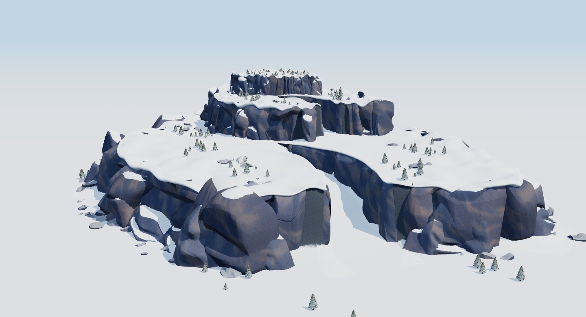

# Nimble in the Forest · передача в новый чат

Обновлено 23 ноября 2026 года. **Работа над горами на паузе.** Последняя просьба владельца — передать контекст через GitHub. Нового поручения переделывать горы после разбора результата не было. Следующую задачу даст владелец.

## С какой горы продолжать разговор

Когда владелец спрашивает «где вот это?», он имеет в виду **трёхъярусную гору из `5a6981b`**. Внизу массив расходится на два широких снежных плеча по сторонам глубокого изогнутого подъёма. Среднее плато смещено вглубь, над ним стоит малая вершина. Форма всего массива и внешний вид его боковины — два разных решения. Последняя боковина у подъёма получила отрицательную оценку. Это не давало оснований заменять всю гору простой игровой заготовкой.

| Этап | Что владелец видел |
| --- | --- |
| `7012c7c` | Одноярусное лесное плато, открытый подъём, округлая кромка снега. [Кадр](https://raw.githubusercontent.com/depthd/nimbleintheforest/f79fcb78595ee1d56df6854ccbe352d112a75649/docs/qa/PLATEAU-001/7012c7ce983f08d8d91bb76bf4e36b65881abd01/front.jpg) |
| `50587b6` | Первая трёхъярусная композиция. На каждом ярусе своя терраса и подъём. [Спереди](https://raw.githubusercontent.com/depthd/nimbleintheforest/f79fcb78595ee1d56df6854ccbe352d112a75649/docs/qa/PLATEAU-001/50587b69d87265298b148cc744dfbc48fa5df467/front.jpg) · [Сверху](https://raw.githubusercontent.com/depthd/nimbleintheforest/f79fcb78595ee1d56df6854ccbe352d112a75649/docs/qa/PLATEAU-001/50587b69d87265298b148cc744dfbc48fa5df467/top.jpg) |
| `5a6981b` | Последний показанный вариант. У входа появились объёмные выступы, трещины и отдельные пятна снега. Для боковин владелец выделил референсы 02, 05, 10 и 11, особенно № 10. [Сзади](https://raw.githubusercontent.com/depthd/nimbleintheforest/f79fcb78595ee1d56df6854ccbe352d112a75649/docs/qa/PLATEAU-001/5a6981b46fb8608f2e662b76c8b1747cfb855ed5/back.jpg) · [№ 10 и результат рядом](https://raw.githubusercontent.com/depthd/nimbleintheforest/f79fcb78595ee1d56df6854ccbe352d112a75649/docs/qa/PLATEAU-001/5a6981b46fb8608f2e662b76c8b1747cfb855ed5/comparison.jpg) · [Промежуточные боковины](https://raw.githubusercontent.com/depthd/nimbleintheforest/f79fcb78595ee1d56df6854ccbe352d112a75649/docs/qa/PLATEAU-001/history-2026-11-20/captures/outcrops/contact.jpg) |

Исходник стенда сохранился. В отдельной рабочей копии `5a6981b` вход с dev-сервера — `/experiments/plateau/mountain.html`. По умолчанию видны три яруса, параметр `?tiers=1` показывает один. Геометрию строит код. Композиция трёх ярусов, их повороты и начальные значения генератора для этого кадра зафиксированы. На стенде свободная камера. Проход персонажем в основной игре на этой геометрии ещё предстоит проверить, если владелец возобновит интеграцию. [Исходник стенда](https://github.com/depthd/nimbleintheforest/tree/5a6981b46fb8608f2e662b76c8b1747cfb855ed5/experiments/plateau) · [Архив заметок и решений](https://github.com/depthd/nimbleintheforest/blob/f79fcb78595ee1d56df6854ccbe352d112a75649/docs/qa/PLATEAU-001/ARCHIVE.md)

Сборщик использует профиль подъёма, отдельную оболочку снега, размещение крупных камней и рощ на каждом ярусе. Именно их сочетание даёт вид на кадре. При прежнем переносе использовали часть алгоритма сколотого камня. Три яруса исходного размера и их взаимное положение в игру целиком не попали. Архивный отчёт для одного из ракурсов фиксирует около 2,08 млн треугольников. Производительность и коллизии такой версии в обычной карте остаются открытыми вопросами. [Код размещения ярусов](https://github.com/depthd/nimbleintheforest/blob/5a6981b46fb8608f2e662b76c8b1747cfb855ed5/experiments/plateau/mountain-tiers.ts) · [Измерения стенда](https://github.com/depthd/nimbleintheforest/blob/f79fcb78595ee1d56df6854ccbe352d112a75649/docs/qa/PLATEAU-001/5a6981b46fb8608f2e662b76c8b1747cfb855ed5/report.json)

## Что на самом деле есть в игре

До последнего прохода уже существовал отдельный игровой тест. В нём были широкий склон, узкая выемка, скальная полка, верхний пик, рабочий канат, пещера и подвесной мост. По ним уже ходили в обе стороны. Не нужно выдавать эти механики за новую реализацию. [Старый игровой тест](https://depthd.github.io/nimbleintheforest/test/)

В PR № 23 за основу взяли именно этот тест. Генератор получил новые сочетания входов и ярусов, подбор берегов моста на разных высотах и островные горы, доступные по мосту. Исправили зазоры для прохода, посадку на местность, устья пещер и снег, добавили осыпи и меню мест. В проверочной игре есть три фиксированных мира, ясный полдень, переключатель «Показать форму» и возврат по F2. Игровую капсулу проверяли на множестве сидов. Владелец посмотрел результат и счёл силуэт слишком примитивным. Геометрия исходного массива, его каньона и снежной кромки целиком сюда не перенесена. [Изменения PR № 23](https://github.com/depthd/nimbleintheforest/pull/23) · [Опубликованное меню горных маршрутов](https://depthd.github.io/nimbleintheforest/mountains/)

Срез кода на момент передачи — `ff7f599`, основная ветка — `claude/friendly-archimedes-onmybq`. Корневой сайт игры, старый `/test/` и новая подборка `/mountains/` публиковались отдельно. В ходе более раннего объединения сохранили указатель на 53 ветки и 21 PR. Тег `archive/2026-11-23` содержит таблицу имён и SHA, по которым можно достать работу. Удаление исторических веток осталось отдельным нерешённым вопросом. [Срез игры](https://github.com/depthd/nimbleintheforest/tree/ff7f59968ddeb68b0a76bddc3eb07ce19a7d6c7c) · [Указатель архива](https://github.com/depthd/nimbleintheforest/blob/1b31be59d9b76844fd25b071fca28bc0b494eca5/branches.tsv)

## Чего хочет владелец

- Одна удобная версия игры. Полезную работу из веток сохранить и объединить. Ранее отвергнутую модель дерева можно убрать. Сначала нужна рабочая голая карта с рельефом и генерацией. Дороги, укрытия и дальнейшие системы строятся на этой основе.
- Гора должна работать как локация. На ней от одного до четырёх ярусов. Доступные плато несут снег и деревья. Недоступный верх может заканчивать массив голой скальной вершиной. На верхних ярусах обычно меньше путей.
- На части гор вся короткая сторона первого яруса плавно переходит в подъём. На других внутрь ведут только узкие выемки. Нужны канат, сквозная пещера с выходом на следующий ярус, тупиковое укрытие и берлога в толще скалы. Подвесные мосты автоматически соединяют пригодные жилые террасы, иногда дают единственный доступ на соседнюю гору.
- Сначала оценивать общий силуэт и границы объектов, затем боковину вблизи. Референсы должны быть простыми, выполнимыми средствами игры и сопоставимыми с игровым кадром. Фотореалистичную подборку владелец отверг. Для готового просмотра нужны игровые материалы, камни и одна ссылка с выбором места.
- Организацию работы берёт на себя исполнитель. В прошлый раз агентов подключили до выбора правильной исходной горы. Значительная работа ушла на маршруты, тесты и публикацию уже знакомого прототипа. Если работа над формой возобновится, первая содержательная проверка — сравнение общего вида с кадром вверху, а боковины — с выбранным № 10. Только затем имеет смысл тратить ресурсы на адаптацию и массовые прогоны.

## Как передавать работу дальше

Ветка `handoff` служит общей точкой входа для новых чатов. Перед очередным переходом обновить этот README в той же ветке, отметить последнее решение владельца, состояние кода и публикации, что осталось открытым, и проверить ссылку после отправки на GitHub. Игровая разработка ведётся от актуальной основной ветки. Владелец предпочитает одну ссылку GitHub и готовую строку для вставки в новый чат.
