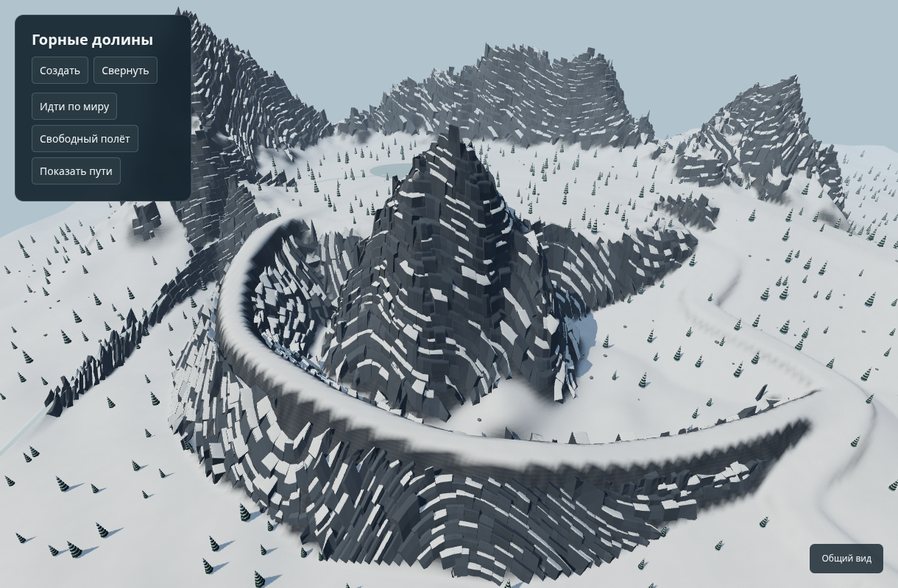
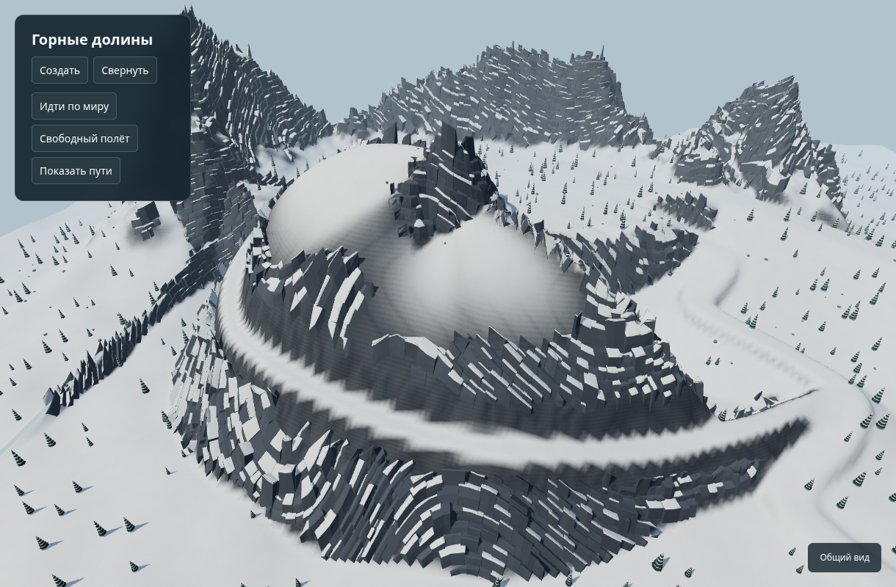
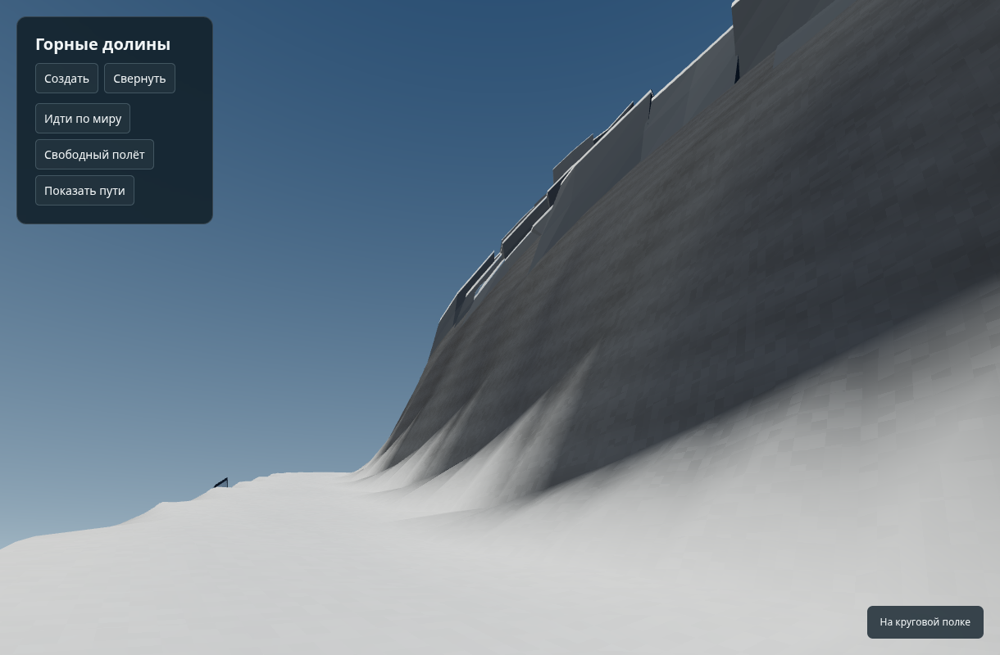

# MOUNTAINS-001 — isolated landform laboratory

First implementation of the mountain/valley design, scoped to a separate experiment. Base `e17417d059d4bf6e096ec6e059de769f71a71914`. No existing game source, assets, dependencies, or workflow changes. The ordinary Vite build adds the laboratory as a second HTML entry while retaining the game entry.

The experiment lives at `/experiments/mountains/` in Vite development. It has an independent build:

```sh
npx tsc -p experiments/mountains/tsconfig.json
npx vite build --config experiments/mountains/vite.config.mjs
node experiments/mountains/test.cjs
CHROMIUM_PATH=/usr/bin/chromium node experiments/mountains/browser.cjs
```

The independent output is `dist/mountains-lab/experiments/mountains/index.html`. The ordinary `npm run build` also includes the lab, so the existing test-only workflow publishes it at https://depthd.github.io/nimbleintheforest/test/experiments/mountains/ . Do not commit dist. The production game is preserved by that workflow.

## Implemented

A 1600 m square, 4 m grid contains lowland forest, a raised forest basin with an irregular floor, enclosed ridges, a frozen lake, and a monotonically descending outlet profile. Three continuous approaches express different geometry: a broad snow apron, a winding gully, and a partial contour shelf around a shoulder. A broad supporting landform under each approach provides its foundation. The contour shelf additionally fills its entire uphill section into a shared rock core before cutting the walkable tread; symmetric support alone left a detached ring and a deep trench. Corridors keep useful clearance rather than placing jumping stones. All are walkable without jumping.

Seed controls upper-floor elevation, rotation/mirroring, route widths/bend, lake shape, noise, vegetation, and rock detail. This is **one composition family**, not a finished repertoire of regional layouts. It demonstrates the relationship between upper/lower living spaces and several passage shapes; it does not yet prove full regional diversity.

Pure `landforms.ts` uses the existing RNG. Triangle sampling matches the displayed collision mesh. Separate renderer uses Three and Rapier already in the repository, instanced placeholder vegetation, batched rocks and the existing **RockSkin / blockTriangles** generators. Rock hulls stream within 70 m, release beyond 95 m, and refresh immediately on teleport. Static shadow maps refresh after relocation or lighting changes rather than every frame. There are view buttons, walking, fly inspection, seed regeneration, route overlays, and day/overcast/evening lighting.

The controller matches capsule size, climb/slide angles, autostep, gravity, walking speed and snow sprint speed of the game. This is an inspection controller; it does not instantiate Player/avatar, stamina, inventory, survival, deformable snow or footsteps. No claim of game integration is made.

## Tests and limits

`test.cjs` checks eight seeds: deterministic full height arrays; finite data; useful elevated gentle dry area and nonflat floor; downhill outlet profile; all three approaches traversed by a Rapier capsule at walking speed; sampled inner cross-sections of the contour shelf must remain supported and rise into the massif. There are 56 checks and 24 complete physical route walks. The cross-section regression fails on the previously published `0097792e3c1c43a9110cef43590ded5b0211a5a9` even though its traversal tests pass. This is a physical walk over final terrain triangles, not merely comparison of route coordinates. It does not include scene decoration; browser validation additionally walks the contour shelf through the full scene.

`browser.cjs` uses actual keyboard events, the page's own fixed movement and streamed collisions; captures eight views, three lighting modes, sequential walking frames, eight seed overviews and a small-screen layout. Capture manifest records source SHA, viewport, graphics backend, scene counts and movement results. SwiftShader measurements are not user hardware FPS. Final results belong to the PR at the exact tested SHA.

The lake/outlet is an authored procedural drainage primitive, **not** a replacement for the game's Priority Flood/hydrology. The outlet surface is visual; only the lake has a dedicated ice collider. Terrain has a prototype resolution of 4 m. Rocks and trees are inspection assets; their style and density are not final art. Long-range terrain/rock LOD, streaming forest colliders, ecological tree-line rules and full navigation/reachability classification remain later work. No caves, ropes, bridges or rewards are implemented at this stage.

Views need artistic acceptance. Numerical width/floor checks do not establish beauty. The initial unadorned terrain made shelves look engineered; broad supporting slopes and reuse of the game's rock skin were added after visual inspection. Further tuning should compare both close ground-level views and overview, not just increase noise or rock count.

## Coordination request before integration

The task card deliberately leaves `owner: null` and `allowed_paths: []`. AGENTS.md assigns those fields to the coordinator; this draft does not self-assign them. Requested scope: `.coord/tasks/MOUNTAINS-001.json`, `experiments/mountains/`, `docs/MOUNTAINS-001.md`, `docs/qa/MOUNTAINS-001/`, and the additional laboratory HTML input in `vite.config.ts`. The experiment modules do not share game implementation files. Coordinator must assign that scope before the task guard can pass and before merging.

The user separately requested publication to the test site. Commit `0097792e3c1c43a9110cef43590ded5b0211a5a9` added the concrete extra HTML input in `vite.config.ts` and was published using the existing test-only workflow. Keep both build inputs when combining tasks. This shared file was originally reserved by UI-001: the coordinator must reconcile its input list with other build changes rather than replace that config wholesale. This PR remains a draft pending formal scope assignment; no PR merge or production release is authorized here.

## Attached shelf correction (landforms-lab-2)

The previous shelf could be walked, but the uphill side descended into a trench, making the passage look like an independent ring. The fix fills radial cross-sections between the shelf and its shared bedrock core, then cuts the tread. Its height rounds into the existing peak; attachment fades at the entry and exit. Nearest-route projection is unsuitable inside the massif because its discontinuities can create sharp artificial fins. The outer drop and all three continuous approaches are retained.

Comparison at seed 42, identical 1220 × 800 camera and renderer. Before is the exact published source `0097792e3c1c43a9110cef43590ded5b0211a5a9`, served locally; after uses the source included with these images. Camera in local coordinates: eye `(100, 320, 400)`, target `(125, 110, 75)`. Ground view uses the existing `ledge` preset. No screenshots are retouched.

| Before | Attached shelf |
| --- | --- |
|  |  |



The regression samples terrain triangles 8–96 m inward along the central shelf sections and checks a wall rise at 36 m. For seed 42 the previous source has a minimum support difference of −88.92 m and fails; the corrected source has +0.59 m and a minimum 36 m wall rise of +41.48 m. These sampled cross-sections and physical walks are evidence for attachment and passage, not a claim that every seed or artistic feature is validated. The upper snow shoulder remains a smooth prototype surface; the broader regional repertoire, ropes, caves and bridges remain later work.

Design and references: https://chatgpt.com/space/page_fe3b8cb4e8148191aa2edbedf75ad3cb . User's additional requirement: varying spaces below/beside/above mountains, straight and winding snow slopes and contour shelves; no regular sequence of isolated stepping stones. Main game remains a mixture of forests, lowlands and mountain districts.
