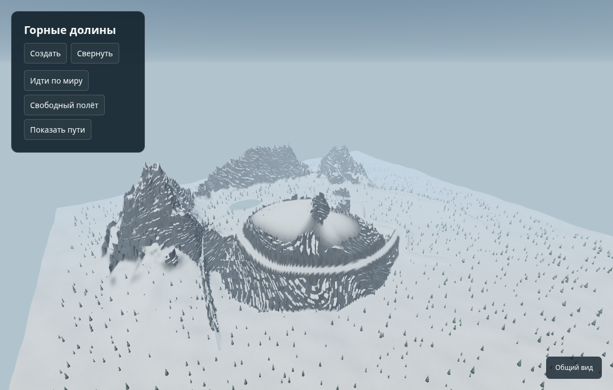
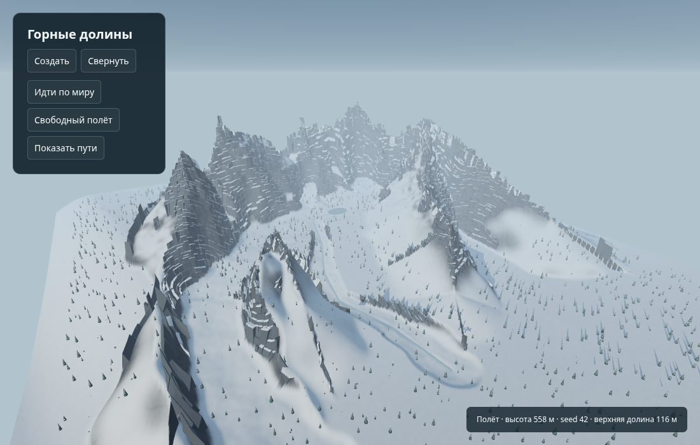
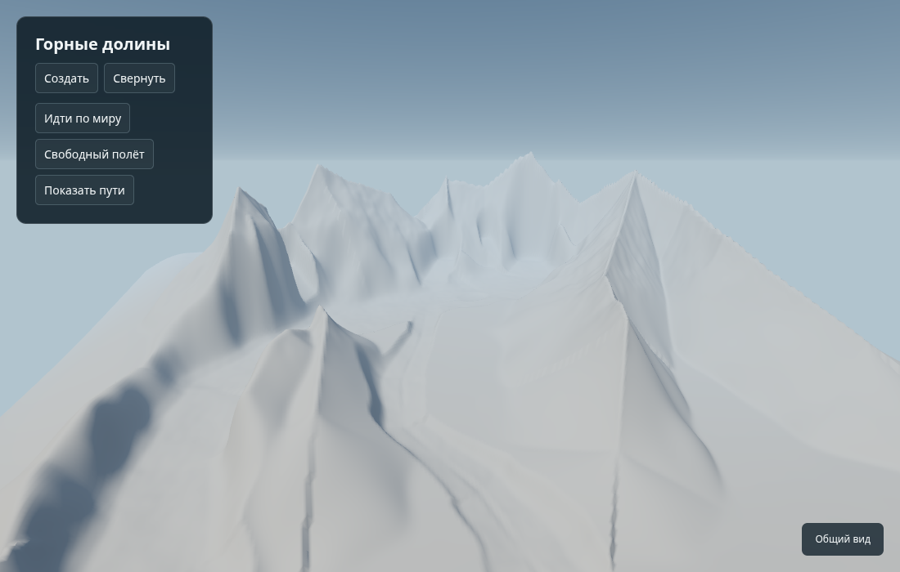
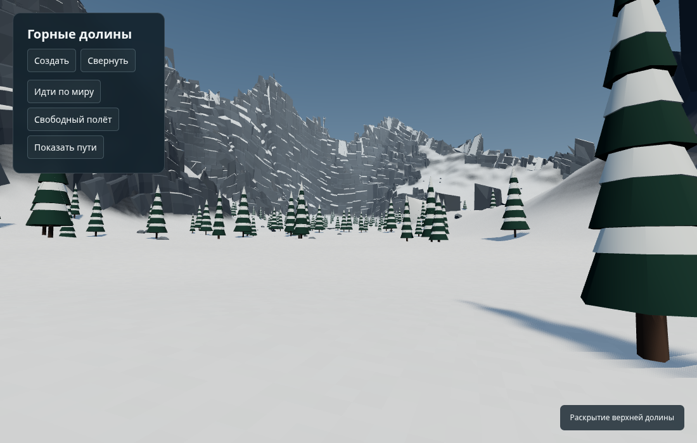
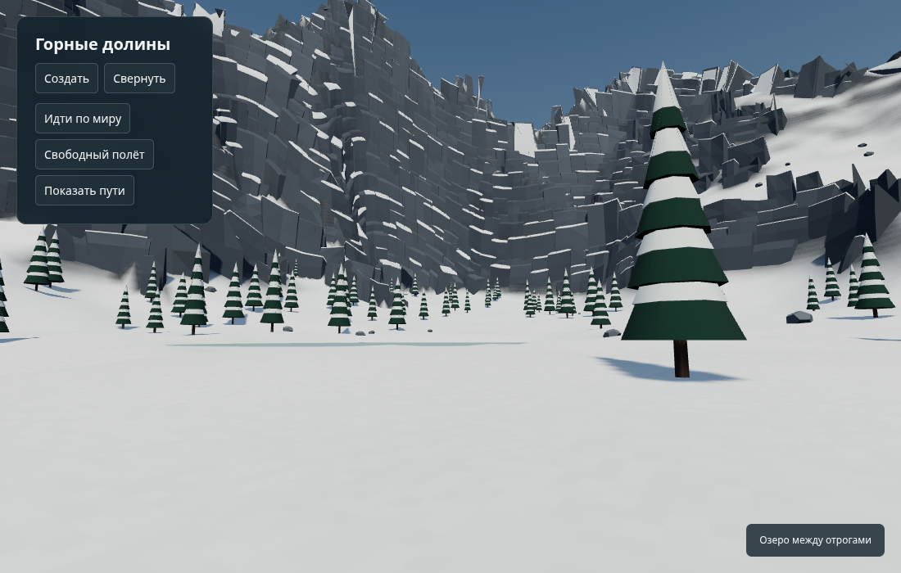
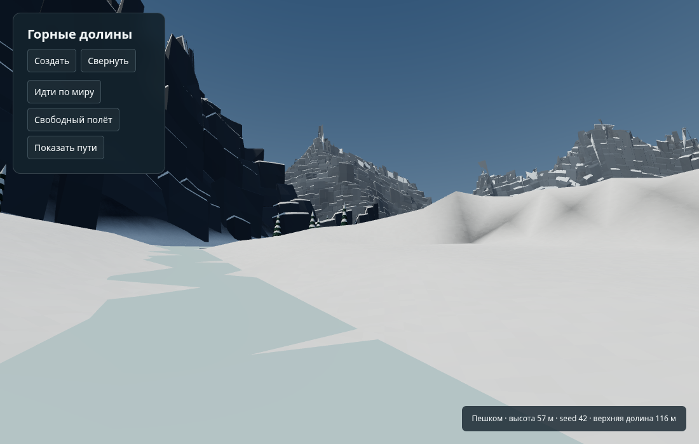
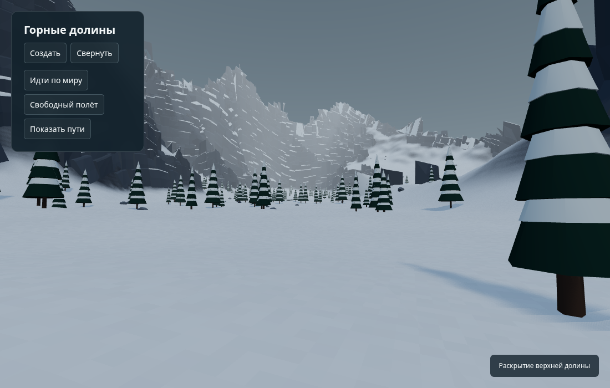
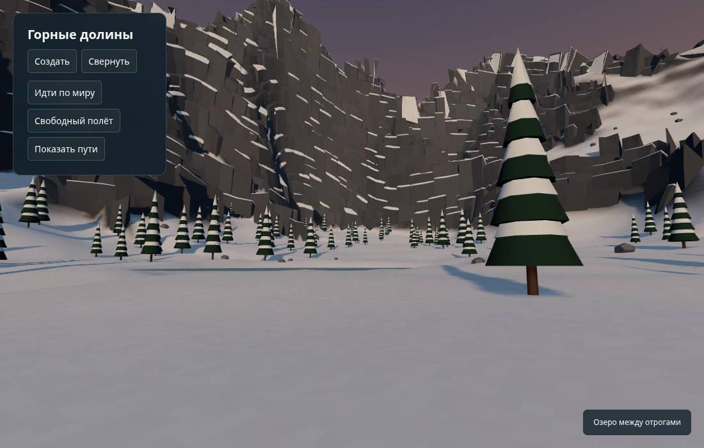

# MOUNTAINS-002 — каркас горного района

Изолированная переделка крупной формы для художественного сравнения. Вместо кольцевой полки и радиального заполнения — связанный водосбор между неодинаковыми гребнями. Два пеших подхода ведут из низины в верхнюю долину; от неё отходят боковые ложбины. Это один экспериментальный район, **не художественно принятый результат и не система разнообразия всего мира**.

Интеграционная база: `e17417d059d4bf6e096ec6e059de769f71a71914`. Исходная лаборатория перенесена из `185989f95ec260455608bb1410eae2a54220b487`. Общие `src/`, `vite.config.ts`, дневник, зависимости и публикационные workflows не меняются. Опубликованный общий тест `f6db29bab0b9bece765831301e76dee5f74b283c` не используется как ветка для перезаписи.

## Почему потребовалась переделка

В исходном прототипе проверены отдельно однотонный грунт, грунт со скалами и полная сцена, а также промежуточные стадии синтеза. Диагностические перехваты выполнялись в памяти Vite; исходники старого прототипа не менялись. Получено 48 кадров, повторно прошли 56 проверок и 24 пеших маршрута старой версии.

- Гауссовы массы и эллиптическое выравнивание задавали небольшой набор похожих плеч и стен, без связанного каркаса средних форм.
- Насыпи под маршрутами и последующее смешивание с их высотой создавали самостоятельные ленты. Проходимость этих лент не обнаруживала художественный дефект.
- `shelfSupport` заполнял внутреннее пространство радиальными профилями, стремящимися к общей высоте 235 м. На seed 42 его отключение меняет итоговый грунт более чем на 0.5 м в 3172 вершинах; максимальная разница — около 163 м. Отключение возвращает прежнюю траншею, поэтому само по себе не является исправлением.
- Артефакты видны на однотонной геометрии: снег и мелкая фактура не являются их первичной причиной.
- Исключение скал в 17 м от маршрута действительно оставляло гладкую стену. Его удаление увеличило число блоков с 7407 до 7853 и выставило большие блоки на проход. Порог 45° вместо 51° дал 8314 блоков с той же картой высот. Эти изменения не выбраны как решение формы.

## Рассмотренные варианты

| Подход | Польза | Ограничение |
| --- | --- | --- |
| Каркас связанных долин и гребней | Управляемые высоты, силуэты, простор и причины проходов | Требует проверки профилей и смешивания с земли; выбран для этого этапа |
| Грамматика пространственных заготовок | Можно тщательно настроить отношения и композиции | Нужны библиотека и хорошие стыки; пока можно лишь заменить один повторяемый шаблон другим |
| Ограниченная эрозия | Существующий модуль подходит для дальнейшего опыта со средними формами | Не устраняет кольцевую структуру и маршрутные насыпи; на этом этапе не добавлена |

## Что изменено

`landforms.ts` строит общее наклонное основание, связанные асимметричные гребни с вершинами и понижениями, основной высокий водосбор и боковые ответвления. Высоты, ширины и стороны склонов меняются вдоль осей. Кандидаты вырезания долин объединяются минимумом, чтобы результат не зависел от порядка перекрывающихся масок.

Крупная форма больше не читает маршруты. Две предполагаемые линии движения считываются **после** построения грунта; нет радиального заполнения, насыпи под линией или завершающего выравнивания коридора. География, план стока и намерения перемещения представлены отдельно. Связи остаются `planned`; подтверждение даёт внешний физический прогон, а не наличие ребра в плане.

Независимые RNG-потоки используют seed, версию и стабильный ID оси/озера/поверхности. Версия — `terrain-frame-1`. Это вариации одной семьи `forked-upland-catchment`, без заявления о доказанном разнообразии районов.

Озеро имеет локальную котловину. Нисходящий выход прорезается в окончательном грунте, чтобы визуальный поток не уходил под землю. Озеро и замёрзший выход имеют отдельные коллизии. `heightAt` продолжает возвращать базовый грунт; запрос видимой ледяной опоры отделён от него. Это авторский локальный водосбор, а не внедрение Priority-Flood основной игры.

Существующий RockSkin используется в масштабированном пространстве: уклоны сохраняются, размер пластов и блоков увеличен в 1.6 раза. Вариант 2.4 отвергнут после просмотра из-за чрезмерно крупных плит. Это настройка оболочки после смены формы, не доказательство геологической естественности. Объединение геометрии, instancing леса, локальная загрузка скальных коллайдеров и статические тени сохранены.

В интерфейсе лаборатории доступны четыре слоя: однотонная форма, грунт со снегом, грунт со скалами, всё окружение. Добавлены смысловые виды нижнего подхода, промежуточного кармана, выхода в долину и бокового ответвления.

## Материалы для оценки

Одинаковые абсолютные камеры, seed 42, ясный день, 1100 × 700, Chromium / ANGLE SwiftShader. Глаз `(-550,560,690)`, цель `(0,120,-170)`. Остальные новые камеры сравнивают смысловые места переработанной географии. Снимки не ретушировались.

| Исходный прототип | Новый каркас |
| --- | --- |
|  |  |



| Раскрытие долины | Озеро между отрогами |
| --- | --- |
|  |  |

| Поворот ложбины | Пасмурный вид | Косой свет |
| --- | --- | --- |
|  |  |  |

Отпечатки четырёх файлов, определяющих сохранённые кадры, находятся в [provenance.json](qa/MOUNTAINS-002/review/provenance.json). Кадры подготовлены до коммита с теми же байтами модели и отображения; точный коммит полного заключительного QA указывается в PR. Манифест нового браузерного прогона отдельно записывает SHA, dirty-state и отпечатки исходников.

## Воспроизведение и проверки

```sh
npm ci
npx tsc -p experiments/mountains/tsconfig.json
npm run build
npx vite build --config experiments/mountains/vite.config.mjs
node experiments/mountains/test.cjs
CHROMIUM_PATH=/usr/bin/chromium node experiments/mountains/browser.cjs
```

Для локального осмотра: `npx vite --host 127.0.0.1`, затем `/experiments/mountains/?seed=42`. В основную конфигурацию сборки второй HTML-вход не добавляется. Автоматическая публикация лаборатории этим PR не выполняется.

Численные проверки используют seed `1,2,3,7,19,42,123,2026` и дополнительные `11,71,314,8191`: детерминизм, конечность высот, связное пригодное верхнее пространство, собственный диапазон высоты, нисходящий план и незарытый в грунт выход воды, фактическое боковое пространство прохода. Rapier проходит оба пути вверх и обратно по финальным треугольникам: 48 полных проходов, 144 проверки. Это проверки свойств, не художественная оценка.

Браузерный сценарий проверяет настоящую клавиатуру, оба пути и возвраты на seed 42 и 7 с растительностью, льдом и скальными коллайдерами, 12 регенераций, четыре слоя, три освещения и мобильное меню. Сохраняются последовательные кадры подхода, середины и выхода. Полный набор — 60 кадров. Результат и точный SHA финального прогона см. в PR.

## Ограничения и следующий выбор

Кольцевой маршрут убран, но это не означает художественную приёмку. На отдельных склонах остаются длинные гладкие поверхности; оболочка местами сохраняет регулярные пласты и острые выступы. Лес — прежний упрощённый декор. Сейчас требуется оценить силуэты, раскрытия и полезность верхнего пространства, затем адресно улучшать слабые места по сравнительным видам.

Нет полной региональной генерации, классификации всех доступных вершин, ограниченных локальных попыток с отбраковкой, канатов, сквозных пещер, мостов, survival Player, игрового снега или полной гидрологии. FPS пользовательского устройства не измерялся. Время SwiftShader не переносится на его оборудование.

Основная игра и опубликованный тест сохранены. PR не объединяется; публикация остаётся отдельным действием после художественной оценки конкретного SHA.
