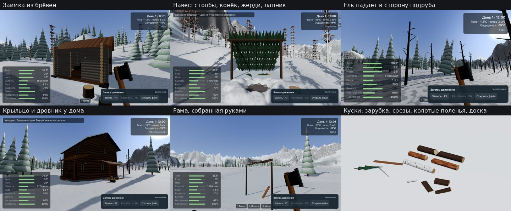

# Дерево: рубка, постройки, строительство

Короткое описание того, как устроены деревья, куски дерева, постройки и
строительство руками. Сначала «для чайников», потом подробности для разработки.



## Коротко

- **Всё деревянное — настоящие куски.** Бревно, жердь, ветка, полено, щепка, доска
  имеют длину, толщину и породу. Вес считается из объёма и влажности.
- **Рубишь там, куда попал.** Каждый удар топора вырубает клин (зарубку) в месте
  удара. Когда зарубка доходит почти до конца, кусок распадается ровно на две части:
  слева и справа от зарубки. Пила режет тонкий пропил, щепы почти не уходит.
- **Дерево падает по физике.** Пока стоит, держит свой вес оставшимся сечением.
  Подрубил с одной стороны — упадёт в сторону зарубки, если не наклонено в другую.
  Пень остаётся той высоты, на какой рубил. Ствол ложится вместе с кроной.
- **Ветки — тоже куски.** Обрубил сук на поваленном дереве — получил именно эту
  ветку (еловую с хвоей — это лапник). С живого дерева рукой можно отломить только
  нижние ветки, до которых достаёшь.
- **Постройки держатся на опорах.** Избушки (сруб из брёвен, фронтоны, конёк, слеги,
  тёс), навесы, крыльцо и дровник у дома, штабели брёвен и всё, что строишь сам,
  состоят из таких же кусков. Каждая деталь знает, на чём лежит, и несёт свой вес,
  снег на крыше и всё, что лежит на ней. Подрубил столб — рухнет то, что на нём
  держалось. Навалило снега — тонкая жердь может сломаться.
- **Строить руками.** Возьми кусок дерева в руки (E), поверни (R, B), подведи к
  месту — полупрозрачный «призрак» покажет, куда он ляжет, а подсказка скажет,
  на что он обопрётся и удержится ли. G — положить или прибить, F — вкопать столб.

## Управление

| Действие | Как |
|---|---|
| Рубить в точке | ЛКМ с топором, прицел на нужное место ствола или бревна |
| Пилить в точке | ЛКМ с ножовкой |
| Расколоть чурбак | ЛКМ с топором по короткому куску (до 0,8 м) |
| Обрубить сук | ЛКМ с топором по ветвям поваленного дерева |
| Распустить бревно на доски | F с ножовкой в руке (долго): доски во всю длину, ширина — сколько позволяет бревно |
| Обтесать бревно в брус | G с топором в руке: самый большой квадрат, что помещается в тонком конце |
| Отломить нижнюю ветку | F у дерева |
| Рубить ниже пень | ЛКМ по пню: верх отделится чурбаком |
| Вытащить деталь из постройки | E (что лежало на ней — упадёт) |
| Повернуть кусок в руках | R — на 45°, B — стоймя / наискось / лёжа |
| Положить в постройку | G (с молотком и гвоздями — «Прибить») |
| Вкопать столб | F, держа кусок стоймя у земли, нужна лопата |
| Уложить бревно в паз | F, когда бревно ложится вдоль другого бревна (нужен топор): без паза круглое на круглом скатится |

## Что видно в подсказке

- У дерева: диаметр, высота, **наклон** («наклон 3° от вас»), насколько подрублено и
  **куда упадёт** («упадёт НА ВАС» — отойдите и подрубите с другой стороны).
- У куска: порода, длина, диаметр, вес, глубина зарубки.
- У детали постройки: насколько она нагружена («нагружено 70%», «трещит под
  нагрузкой!»).
- Когда несёшь кусок: на что он ляжет и удержится ли.

## Как падает дерево

Ствол над зарубкой давит на то, что от сечения осталось. Его вес приложен в центре
масс, и он не над серединой оставшейся древесины: дерево немного наклонено, ветер
давит на крону, а зарубка сместила оставшееся дерево в сторону. Получается изгиб.
Когда напряжение на краю оставшейся древесины больше, чем выдержит сырое дерево,
ствол поворачивается на краю — «петле» — в сторону смещения.

Что из этого следует (как в жизни):

- Подруб с одной стороны: дерево уходит в сторону подруба, когда остаётся
  ~10–15 % сечения.
- Правильная валка: подруб со стороны, куда наклонено дерево, затем запил с другой
  стороны чуть выше — падает в сторону подруба.
- Если подрубить против наклона, дерево «сядет» назад и упадёт на того, кто рубит.
- Ветер помогает или мешает.
- Толстое дерево рубится намного дольше тонкого (объём клина растёт как квадрат
  глубины). С двух сторон быстрее, чем с одной.
- Падающий ствол может зацепиться за соседнее дерево и повиснуть.
- Падающий ствол бьёт игрока, если тот под ним.

## Как держатся постройки

Каждая деталь — кусок дерева в неподвижном положении. Между деталями — соединения:

- **лежит на** (rest): может только давить, не тянуть; круглое бревно на одном
  круглом бревне скатывается, в ложбине между двумя — лежит;
- **вкопано** (set): держит изгиб, тем лучше, чем глубже (как квадрат глубины);
- **врублено / заправлено** (notch): лежит и не скатывается (лапник на жердях);
- **прибито** (nail): держит и тянущую силу, но ограниченно (по числу гвоздей).

После любого изменения (удар, распил, вынутая или добавленная деталь, снег)
считается статика: нагрузка идёт сверху вниз по опорам и делится между ними по
правилу рычага. Каждая деталь проверяется как балка (изгиб; зарубка ослабляет
сечение именно там), как стойка (сжатие и продольный изгиб — тонкая длинная жердь
сначала гнётся) и по соединениям. Что не держится, отпускается и падает как обычный
кусок — тот же самый. Сломанная балка ломается в месте наибольшей перегрузки.

Пример порогов: жердь ⌀8 см пролётом 3 м, несущая 2,5 м пологой кровли, ломается
примерно под 30 см слежавшегося снега, ⌀12 см — около метра. Снег держится на
скатах до 30° целиком, круче — соскальзывает, с 60° не держится вовсе (как в
строительных нормах), поэтому крутая крыша выдерживает больше.

## У дома

Крыша крыльца и дровник — тоже детали: столбы (у крыльца — в гнёздах каменного
цоколя, у дровника — вкопаны), балка на них, брус, прибитый к стене дома, и доски
от стены вниз через балку. Подрубите столб — крыша сложится. Сам дом пока прежний.

## Избушки

Заимки и рыбацкие избушки — срубы: венцы из брёвен, перекрещённые на углах и
лежащие на угловых камнях; в передней стене дверной проём с перемычкой; фронтоны из
укороченных брёвен под линией крыши; конёк, слеги и доски-тёс, на которых копится
снег. Каждое бревно лежит на нижнем по всей длине и на поперечных на углах, поэтому
сруб очень прочный: перерубленное бревно остаётся на месте, венцы выше лежат на
остальных. Нижнее бревно не вытащить руками — его прижимает вся стена сверху.

Если снять тёс или прорубить стены, укрытие становится хуже: внутрь задувает ветер,
тепла меньше, снег падает внутрь.

## Инвентарь

Мелочь — ветки, лапник, поленья, щепа — показывается одной охапкой по весу
(«Дрова 6,4 кг»). Доски и жерди — штуками, в карточке видна длина каждой.
В рюкзак не влезает то, что длиннее ~1–1,8 м или тяжёлое: это несут в руках или тащат.
Время горения в огне пропорционально весу куска; в печь не влезает длинное и толстое.

## Для разработки

- `src/game/wood/piece.ts` — модель куска: размеры, зарубки, ветки, объём и масса,
  рубка (`chop`), сквозной разрез (`cutAt`), колка (`splitAlong`), категории и имена.
  Чистая математика, тестируется без игры.
- `src/game/wood/felling.ts` — когда и куда падает подрубленное дерево.
- `src/game/wood/mesh.ts` — геометрия: ствол с вырезанными клиньями, колотые
  поленья, доски, лапник. Свежий срез светлее коры (атрибут `cut`).
- `src/game/wood/wood.ts` — куски как игровые объекты: физика, удары, колка, сучья.
- `src/world/forest.ts` — лес: деревья рисуются инстансами, пока их не тронули;
  затронутое дерево получает свой ствол и меш, падает на шарнире, оставляет пень.
- `src/game/build/statics.ts` — статика построек (чистая математика).
- `src/game/build/build.ts` — постройки в мире: детали, проверки, снег на крышах,
  обрушение.
- `src/game/build/place.ts` — строительство руками: призрак, опускание и доворот
  на опоры, предпросмотр «удержится ли».
- `src/game/resting.ts` — куски в покое: усыпление неподвижных куч, склейка
  улёгшихся кусков в общие меши.
- `src/game/merge.ts` — много неподвижных объектов одним мешем на материал, с быстрым
  «выниманием» одного из них.
- Отладочная страница `?preview=wood` показывает куски крупно без генерации мира.

### Чтобы кадр не проседал

Сотни деталей и обломков стоят дёшево, если они не двигаются:

- **Детали построек** — коллайдеры на одном общем неподвижном теле, а не по телу на
  деталь. Каждая постройка рисуется одним мешем на материал. Подрубленная или новая
  деталь мгновенно вынимается из общего меша (её треугольники схлопываются) и рисуется
  отдельно; общий меш пересобирается, когда в постройке 2,5 с ничего не меняется.
- **Статика** после удара по детали пересчитывает только эту деталь с нагрузками из
  прошлого полного расчёта; всю постройку — только если деталь не выдержала. Полный
  расчёт берёт готовый результат для каждой детали, у которой не изменились ни кусок,
  ни опоры, ни приходящие нагрузки, поэтому каскад обрушения считает только то, что
  рядом с упавшим. Изгибающие моменты — по накопленным суммам сил, без перебора всех
  сил в каждой точке.
- **Обломки засыпают.** Круглое бревно на круглом бревне может дрожать бесконечно и
  держать проснувшейся всю кучу. Раз в 0,4 с группа соприкасающихся кусков, где
  каждый за три проверки подряд сдвинулся меньше 2 см и повернулся меньше 3°,
  усыпляется целиком. Проснувшийся кусок (его толкнули, из-под него убрали опору)
  снова должен постоять спокойно, поэтому падающее в воздухе не замирает. Дальше
  120 м от игрока пороги мягче.
- **Улёгшиеся куски дерева** через секунду сна склеиваются в общий меш по участкам
  32 × 32 м и по размеру (мелочь не рисуется дальше 70 м, средние дальше 160 м,
  крупные дальше 400 м). Проснувшийся, поднятый, подрубленный кусок сразу вынимается
  и рисуется сам; участок пересобирается, когда в нём 1,5 с тихо.
- **Физика догоняет** не больше трёх шагов за кадр: ниже 20 кадров в секунду игра
  замедляется, а не тратит всё больше времени на физику.

Тесты:

```bash
npm run test:statics        # статика и куски без браузера
npm run test:wood-browser   # валка, сучья, разрез, колка в игре
npm run test:build-browser  # навес, снег, штабель, строительство руками
```

## Ограничения сейчас

- Главный дом пока прежний — цельный, со своей тепловой моделью; его стены и окна
  разрушаются по-старому.
- Полный расчёт статики сруба — 1–2 мс; при перерубании бревна, от
  которого рушится полизбушки, возможна заминка в пару десятков миллисекунд.
- Трещины не бегут вдоль волокон сами: кусок делится только в месте удара или
  колется вдоль.
- Брёвна, лежащие на земле, проваливаются в снежный покров до грунта (как и все
  предметы). Крупное дерево под слоем снега до 40 см можно рубить и брать прямо
  через снег; мелочь нужно откапывать.
- Тяжёлые незакреплённые куски, лежащие на постройке, давят на неё; упавший сверху
  кусок на мгновение бьёт с силой в несколько раз больше своего веса (дерево,
  поваленное на навес, проломит его). Игрок, стоящий на детали, тоже её нагружает.
- Сохранений в игре ещё нет; данные кусков и построек — обычные объекты, их можно
  будет сохранять.
