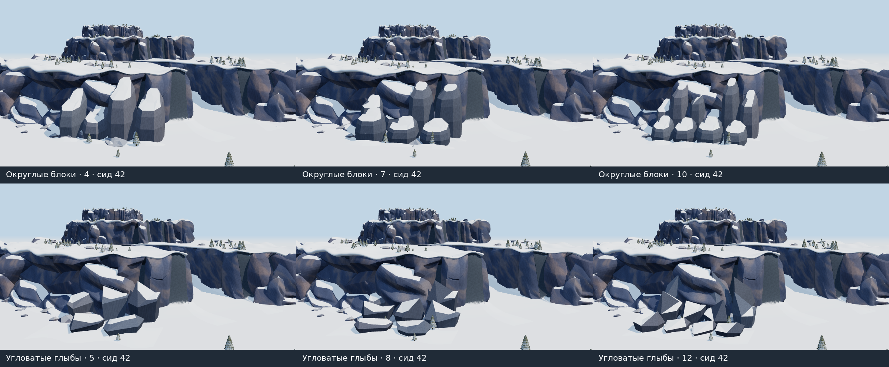

# Горы Nimble · срез для приёмки

Игровая сборка `cb4e6f41e07992b8008a3d1452880e6f2788f473`, ветка `integration/mountains-1`, база `f79fcb78595ee1d56df6854ccbe352d112a75649`. Последующие коммиты хранят проверку этой сборки. Шесть агентов работали по семи заданиям. Ярусы и входы вёл один агент, поскольку их формирует одна сетка.

На **полноразмерной горе из архива** у нижнего подъёма доступны исходный вид и шесть пресетов. **Пеший срез** открывается по ссылке из просмотрщика. Это две горы в масштабе игрового персонажа, первое плато находится на высоте 14 м. Прогулка охватывает ту же выбранную боковину, канат, проход между ярусами, логово и мост. Перенос маршрутной генерации в полный регион остаётся отдельной работой. Внешний вид и приёмка ветки — решение владельца.

[Контактный лист 2×3](wall-rounded/walls-seed42.png) · [Средние пресеты на новом сиде](integration/new-seed.jpg) · [Входы и ярусы](integration/tiers-entries.jpg) · [Кадры пройденного маршрута](integration/journey.jpg)

## Направления

| Направление | Ветка | База → результат | Проверено и что осталось |
|---|---|---|---|
| R | `track/references` | `f79fcb7 → a5c85c6` | PASS · По шесть референсов на четыре темы. Для каждого есть источник, пространственный признак и ограничение PS1. На листах авторские эскизы. Для части игровых статей доступен поисковый индекс. [Листы и источники](references/README.md) |
| WA | `track/wall-rounded` | `f79fcb7 → e0e66ef` | PASS · 4, 7, 10 замкнутых масс, ширина до трети участка, снеговые шапки. Буквальное совпадение снаружи при движении тени — FAIL. [Снимки и геометрия](wall-rounded/README.md) |
| WB | `track/wall-angular` | `f79fcb7 → ae0bfe8` | PASS · 5, 8, 12 клиньев, проверены повторяемость и опора под снегом. Та же оговорка по тени. Тёмная плита справа — исходный борт вырезанного подъёма; в неё попадают лучи контрольной камеры. [Замеры и лучи](wall-angular/README.md) |
| T | `track/tiers-entries` | `f79fcb7 → e202a41` | PASS · В выборке есть все 1–4 яруса, жилые площадки с деревьями и недоступные пики. T4 частично · сохранение всей формы при переносе в полный регион предстоит проверить. [Физика и кадры](tiers-entries/README.md) |
| E | `track/tiers-entries` | `f79fcb7 → e202a41` | PASS · Широкая сторона и узкий извилистый вырез пройдены игровым персонажем. На сиде 3 в одном регионе есть горы обоих типов. [Живая прогулка](tiers-entries/live-walk.json) |
| P | `track/passages` | `f79fcb7 → 7e59e46` | PASS · Канат пройден в обе стороны. В одной сцене персонаж вышел из сквозной пещеры на 22 м и вернулся. В тупике капсулу остановила задняя стенка. [Поручение, коллизии и кадры](passages/DECISION.md) |
| B | `track/bridges` | `f79fcb7 → 64dedb0` | PASS · На четырёх сидах спутник доступен через мост. При выключенном настиле граф теряет связь и капсула падает в разрыв. Восемь проходов по настилу в обе стороны. [Профиль и измерения](bridges/REVIEW.md) |

## Боковина



Доля снега измерена в движке у видимых треугольников боковины с учётом перекрытий. Маска отдельно считает скалу, снежные пятна и сугроб у подножия. В знаменатель входят видимая скала и снег на самой стенке. Камера и размер кадра одинаковы — 800 × 450.

| Сид 42 | Масс | Снег на стенке | Треугольники в проходе камеры | Медиана программной отрисовки |
|---|---:|---:|---:|---:|
| Исходная | — | — | 2 097 636 | 2,68 с |
| Округлые блоки | 4 | 26,83% | 2 087 612 | 2,67 с |
| Округлые блоки | 7 | 24,36% | 2 087 960 | 2,61 с |
| Округлые блоки | 10 | 24,83% | 2 088 308 | 2,55 с |
| Угловатые глыбы | 5 | 25,61% | 2 087 452 | 3,18 с |
| Угловатые глыбы | 8 | 27,58% | 2 087 553 | 2,61 с |
| Угловатые глыбы | 12 | 27,22% | 2 087 622 | 2,57 с |

Замер сделан в отдельном сеансе Chromium/SwiftShader. Для каждого пресета отброшен первый вызов, затем взята медиана трёх синхронных вызовов render с чтением пикселя. Исходная стенка в конце прогона дала 2,67 с. Производительность целевого игрового GPU **НЕ ПРОВЕРЕНА**. Предложение для следующего среза — использовать 2 097 636 видимых треугольников исходной камеры как верхнюю границу сравнения; бюджет миллисекунд задавать по замеру на игровом GPU. [Сырые времена](integration/wall-timing.json) · [Число пикселей и дополнительные сиды](integration/final-walls/report.json)

На исходном пресете все 360 000 пикселей совпали с кадром архивной базы. В вариантах настоящая тень меняет за пределами стенки 775–1 318 пикселей. При отключённом приёме теней на той же камере за пределами стенки совпали все пиксели во всех шести вариантах. Восемь конфигураций проверены на пересечение масс и верхнего плато. Все 225 пар масс разделены, минимальный зазор между ними 1,609 м. Левый и правый края выреза относятся к исходной горе. [Сравнение теней](wall-rounded/outside-wall.json) · [Замер пересечений](integration/wall-intersections.md)

На семи крупных ракурсах каждый из средних пресетов осмотрен на дуге 24°. У восьми угловатых глыб исходный пунктир исчез после доработки камня под снежной шапкой. Один смешанный пиксель сохраняется в точке, где сходятся три грани. Контроль девяти ракурсов выявил 0 пикселей изменения видимости соседних объектов. Такой же крупный проход для остальных четырёх пресетов **НЕ ПРОВЕРЕН**. [До и после](wall-angular/snow-ridge-before-after.jpg) · [Серия ракурсов](wall-rounded/seams.jpg)

В отдельной проверке штатными элементами меню выбран новый сид, затем страница перезагружена. Сид, пресет и кадр сохранились, переключение на исходную стенку восстановило каждый пиксель. [Проверка меню](integration/wall-controls.json)

## От спавна до соседнего плато

Сначала персонаж обходит боковину и заходит в логово, упирается в камень и возвращается к единственному входу. По канату он поднимается на первый ярус. По пещере выходит на второй ярус и возвращается тем же ходом. Затем он идёт по первому плато и переходит мост. Все отметки одного сида записаны в одной загрузке, позицию персонажа на пути задаёт игровой контроллер и Rapier. В длинном тесте Playwright нажимает клавиши; диагностический интерфейс поворачивает взгляд и продвигает игровой такт на 1/60 с. Отдельно проверены мышь, захват указателя и ходьба W в обычном реальном времени. [Проверка обычного ввода](integration/realtime/README.md)

| Сид | Ярусы, основная / соседняя | Вход основной горы | Пройдено | Высота финиша |
|---:|---|---|---:|---:|
| [42](integration/seed-42/metrics.json) | 3 / 3 | узкий вырез | 442,51 м | 14,03 м |
| [7](integration/seed-7/metrics.json) | 2 / 3 | широкая сторона | 444,44 м | 14,03 м |
| [8191](integration/seed-8191/metrics.json) | 4 / 1 | широкая сторона | 456,68 м | 14,03 м |
| [23011](integration/seed-23011/metrics.json) | 2 / 1 | узкий вырез | 448,60 м | 14,03 м |

На дополнительном сиде 3 у главной горы вырез, у соседней — широкая сторона на подъёме с её первого яруса. На сидах 46, 53 и 55 исправлен пустой лес на маленьком жилом ярусе. На сиде 7 обычная клавиша W довела от подножия на высоту 14,03 м.

Открытый разрыв между берегами составляет 30 м. Настил опирается на берег по метру с каждой стороны, расстояние между опорами — **32 м**, провис у середины — 1,765 м. **32 м предлагается для этого стенда.** Для других форм ущелья и игрового региона требуется отдельный замер.

## Открыть и воспроизвести

В готовой ZIP-сборке запустите `python start.py` (в Windows также `py start.py`). Откроется исходная боковина с камерой у подъёма. Локальный сервер выводит адрес в терминале.

Из исходников на ветке `integration/mountains-1` установите зависимости и запустите Vite из корня игры.

```sh
npm ci
npm run dev -- --host 127.0.0.1 --port 5184
```

[Посмотреть исходную стенку](http://127.0.0.1:5184/experiments/plateau/mountain.html?view=wall) · [Сравнить два семейства](http://127.0.0.1:5184/experiments/plateau/mountain.html?wall=rounded&preset=1&seed=42) · [Пройти маршрут](http://127.0.0.1:5184/experiments/plateau/route.html?seed=42&wall=rounded)

История Git поставляется двумя ZIP. Распакуйте оба и укажите пути к `mountains.bundle` и `mountains-final.bundle`. Первая часть устанавливает исходную историю срезов, вторая — окончательную правку и проверенные кадры. Эти команды сохраняют текущую рабочую ветку и создают отдельную папку для проверки.

```sh
git fetch origin refs/heads/task/PLATEAU-001-rock-masses
git bundle verify /path/to/mountains.bundle
git fetch /path/to/mountains.bundle 'refs/heads/*:refs/remotes/mountains-review/*'
git bundle verify /path/to/mountains-final.bundle
git fetch /path/to/mountains-final.bundle 'refs/heads/*:refs/remotes/mountains-review/*'
git worktree add --detach ../mountains-review refs/remotes/mountains-review/integration/mountains-1
```

[Планы и промпты для семи направлений](CONTEXT.md) · [Архивные ветки](archive-branches.tsv) · [Указатель исторических правок и файлов](archive-changes.tsv)

Для проверки сборки используются `npm run build` и `npx tsc -p experiments/plateau/tsconfig.json`. Модульные проверки боковины, рельефа, пещер и моста лежат рядом с реализацией. Скрипты браузерных прогонов требуют Playwright и Chromium. Точные команды, кадры и ограничения для каждого направления приведены в строках таблицы выше.

На приёмку остаются форма боковины, допустимость изменения солнечной тени у подножия и предложение по длине моста. Перенос в полный регион и аппаратный бюджет — следующие этапы после просмотра среза.
