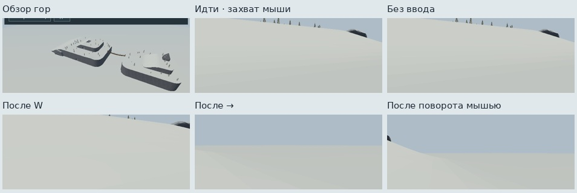

# Обычный игровой ввод · сид 7

**PASS** в Chromium на статической сборке `1edaa03`. Из просмотрщика боковины открыли «Пеший маршрут с пещерами и мостом», ввели сид 7, нажали «Открыть срез», «Обзор гор» и «Идти». Браузер захватил указатель мыши на игровом холсте. Страница работала в реальном времени с исходной боковиной. У неё отсутствовал тестовый интерфейс `__route`. Модули игры и Rapier загрузились из каталога статических ресурсов. Браузер зарегистрировал 0 ошибок консоли и страницы, 0 неудачных запросов.

Сравнили одни и те же 620 × 247 пикселей после каждого действия. Пиксель считали изменившимся при разнице яркости хотя бы одного цветового канала больше 8 из 255. В покое изменилось 0% пикселей, после W — 22,87%, после стрелки вправо — 69,79%, после движения мыши — 10,57%. W удерживали 70 кадров браузера, стрелку — 18. Положение персонажа в этом опыте не измеряли. [Данные и список загруженных модулей](metrics.json)
