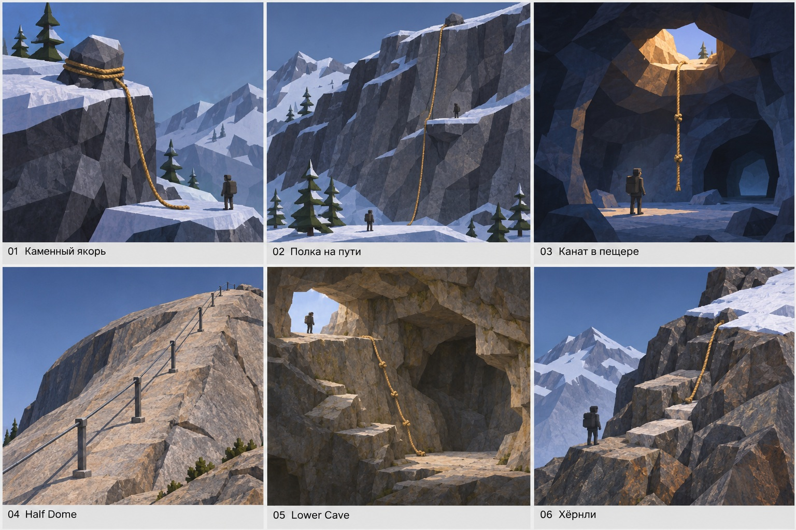
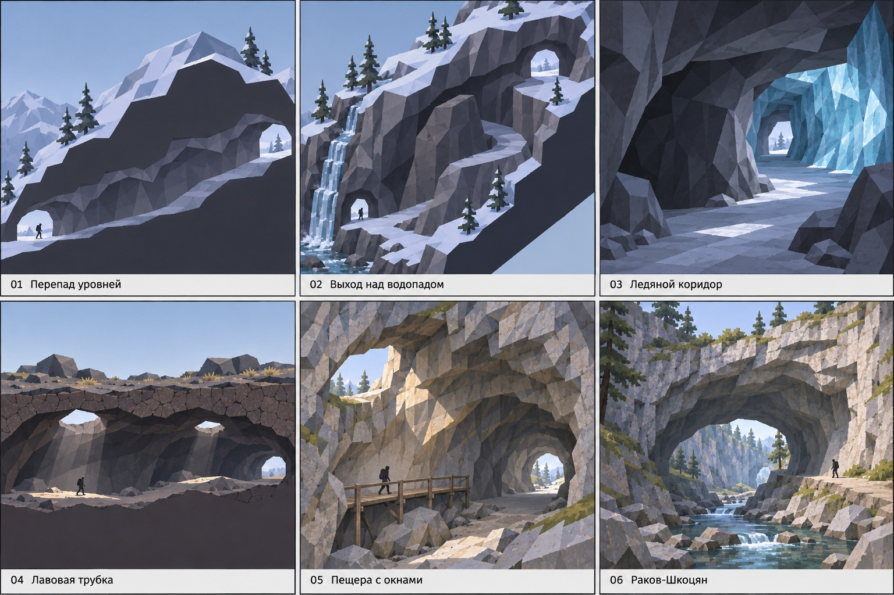
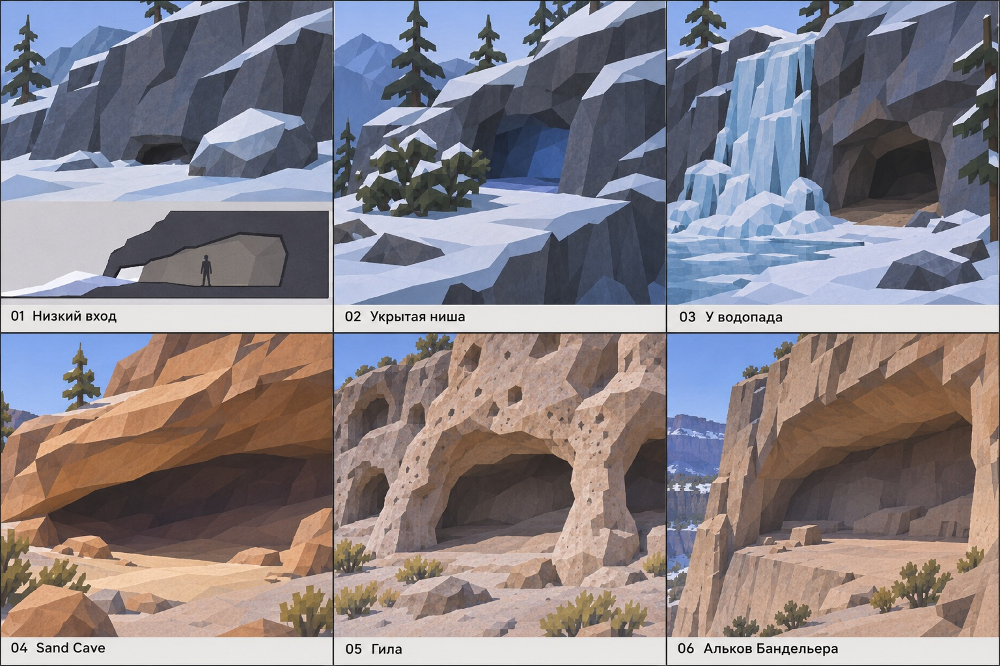
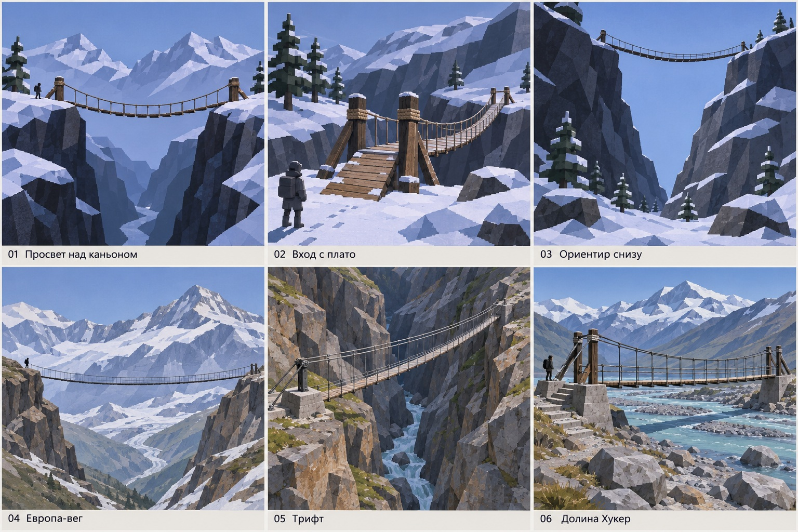

# Маршруты в горах · четыре контактных листа

Для срезов P и B. Основа игры — `f79fcb7`. На каждом листе шесть авторских эскизов, сгенерированных по пространственным признакам источников. Верхний ряд разбирает игровые ситуации The Long Dark, нижний — натурные аналоги. Под каждым листом указано, какую деталь подтверждает источник и как упростить её в Nimble. Рисунки условны. Фотографии, игровые кадры и описания открываются по ссылкам.

Один проход для сравнения в игре: увидеть вход с нижней площадки, подойти, осмотреть пол и раскрытие маршрута, пройти до доступного верхнего яруса и посмотреть назад. Для тупика четвёртая точка — задняя стена и вид назад на тот же вход. Масштаб, просвет для капсулы, коллизии и освещение проверяет игровой срез.

## Подъём по канату

| № | Источник | Что перенести в срез | Что упростить для PS1 |
|---|---|---|---|
| 01 | [Ash Canyon, официальный кадр верхнего крепления](https://www.thelongdark.com/img/hesitant_prospect_carousel_5_comp.jpg) | Открытый каменный якорь и линия через край площадки. Со стороны верха виден первый метр спуска. | Обозначить обхват камня одним крупным витком. Мелкое плетение пропадает на расстоянии. |
| 02 | [Подход к Homesteader’s Respite, описание длинного подъёма с полкой](https://thelongdark.fandom.com/wiki/Miner%27s_Folly) | Показать промежуточную площадку сбоку от линии, с читаемым местом для схода. | Разбить профиль стены на две большие массы. Мелкие зубцы скрывают место схода. |
| 03 | [Hushed River Valley, короткие канаты внутри Ice Cave](https://thelongdark.fandom.com/wiki/Ice_Cave) | Внутри пещеры канат обозначает вертикальный участок. Верхняя кромка и нижний пол помогают оценить высоту. | Достаточно разницы яркости верёвки и стены. Детальные блики льда и светящийся мох отвлекают от линии. |
| 04 | [Half Dome, NPS](https://www.nps.gov/yose/planyourvisit/halfdome.htm) · [фото тросов на куполе](https://www.nps.gov/yose/planyourvisit/images/Half-Dome-Cables-735.jpg?maxwidth=650) | Пара линий раскрывает уклон скалы. Это аналог наклонного участка подхода. | Узкие стойки и дальние тросы сливаются. Сохранить силуэт линии и несколько опор крупного масштаба. |
| 05 | [Lower Cave, NPS, описание верёвки у наклонного входа](https://www.nps.gov/thingstodo/lower-cave-tour.htm) | Размещать точку входа у фактического перелома пола. Подъём начинается на доступной опоре. | Узлы обозначить несколькими крупными утолщениями. Мелкий рельеф известняка вынести в текстуру. |
| 06 | [Хёрнли, галерея местных гидов](https://www.zermatters.ch/en/activities/climb/summit-tour/article/matterhorn/) · [участок с закреплёнными верёвками](https://www.zermatters.ch/fileadmin/_processed_/b/2/csm_matterhorn-fixseile-oben_211d84855e.jpg) | Короткая закреплённая линия у скального перегиба естественно связывает две опоры. | Мелкие карабины и параллельные нити дают рябь. Оставить линию с достаточной видимой толщиной. |

## Пещера-проход между ярусами

| № | Источник | Что перенести в срез | Что упростить для PS1 |
|---|---|---|---|
| 01 | [Переход Bleak Inlet — Forlorn Muskeg](https://thelongdark.fandom.com/wiki/Cave_%28Transition_Zone%29) | Один извилистый ход соединяет точки разной высоты. Контрольные виды — вход снизу, перелом пола, выход наверху. | Построить несколько широких поворотов. В срезе сохранять одну непрерывную сцену. |
| 02 | [Long Falls — Miner's Folly, горная пещера](https://thelongdark.fandom.com/wiki/Cave_%28Ash_Canyon_location%29) | Приметная форма у нижнего входа и верхний выход с другой панорамой помогают узнать место после подъёма. | Каскад передать крупной ледяной плоскостью. Сложная вода и развилки для первой проверки лишние. |
| 03 | [Ледяная пещера на пути через Keeper’s Pass](https://thelongdark.fandom.com/wiki/Ice_Cave) | Для линейного прохода достаточно смены направления и одного отличимого внутреннего объёма. | Большие холодные грани и контраст пола со стеной. Прозрачность и отражения на каждой грани усложняют чтение. |
| 04 | [Nāhuku, лавовая трубка, NPS](https://www.nps.gov/places/nahuku.htm) · [фото профиля](https://www.nps.gov/common/uploads/cropped_image/primary/E9F518AD-FA51-5A78-BBD2E2242E31C563.jpg?width=800) | Непрерывный свод даёт проходу узнаваемый поперечный профиль. В игре пол можно поднять к верхнему порталу. | Сегментированный свод и крупные грани заменяют детальную морщинистую поверхность. |
| 05 | [Pokljuška luknja, описание двух входов и трёх окон](https://www.bled.si/en/what-to-see-do/attractions/7/pokljuska-soteska-gorge/) | Свет из бокового окна может подсказать поворот. Высоко расположенное окно и ходовой выход различаются по уровню пола. | Для первого прохода достаточно одного светового проёма. Выступы возле него не должны становиться случайной лестницей. |
| 06 | [Rakov Škocjan, карстовая долина и природные арки](https://notranjski-park.si/en/discover/natural-landmarks/rakov-skocjan) | Вид насквозь связывает планы, толщина арки показывает сохранённый каменный потолок. Сухая боковая дорожка на эскизе — предложение для Nimble. | В игровой геометрии важны края отверстия и форма свода. Мелкая осыпь и растительность могут закрыть выход. |

## Тупиковая пещера в скале

| № | Источник | Что перенести в срез | Что упростить для PS1 |
|---|---|---|---|
| 01 | [Climber’s Cave, маленькое укрытие на верхней площадке](https://thelongdark.fandom.com/wiki/Climber%27s_Cave) | Малый объём и узкий порог позволяют охватить внутренность одним взглядом. Признак тупика — сплошная задняя стена. | Один крупный нависающий клин и боковой камень образуют вход. Убрать мелкие предметы из силуэта. |
| 02 | [Valley Cave, укрытие за кустами](https://thelongdark.fandom.com/wiki/Valley_Cave) | Сбоку вход частично скрыт. С тропы остаются видны тёмный проём и непрерывная полоса пола. | Достаточно одного выступа или крупного силуэта куста. Множество прозрачных веток закрывает ориентир. |
| 03 | [Narrow Falls Cave, небольшая пещера рядом с водопадом](https://thelongdark.fandom.com/wiki/Narrow_Falls_Cave) | Холодный внешний ориентир отличает место. Внутренняя ниша глубже снеговой границы и закрыта сзади. | Ледяная форма и две градации освещения заменяют частицы брызг и мягкую полутень. |
| 04 | [Sand Cave, Cumberland Gap, NPS](https://www.nps.gov/cuga/planyourvisit/caves.htm) · [вид из-под свода](https://www.nps.gov/cuga/planyourvisit/images/Sand-Cave-View-Looking-Out.jpg?maxwidth=650) | Широкий навес над пологим дном даёт читаемый приют. В обзоре снаружи виден задний предел выемки. | Выбрать одну силуэтную кромку. Многоцветная фактура песчаника в мелком масштабе создаёт шум. |
| 05 | [Gila, Cave 1, NPS](https://www.nps.gov/places/cave-1-a-good-place-for-the-family-home.htm) · [пол скального алькова](https://www.nps.gov/common/uploads/cropped_image/primary/8C83A8C1-E5EA-5F49-9BEA9D8DF995D7B7.jpg?width=800) | Природная выемка имеет полезный горизонтальный пол и защищённую заднюю часть. Форма пола определяет область убежища. | Намечать пол крупными плоскостями. Исторические постройки относятся к реальному месту и в игровой срез не входят. |
| 06 | [Bandelier, Alcove House, NPS](https://www.nps.gov/band/planyourvisit/alcove-house.htm) · [панорама ниши](https://www.nps.gov/band/planyourvisit/images/alcove-house-panorama.jpg?maxwidth=950) | Вход может лежать высоко над дном долины. Единая линия потолка соединяет полку со стеной. | Вынести в геометрию свод, заднюю стену и посадку пола. Детали породы и исторической кладки здесь избыточны. |

## Подвесной мост

| № | Источник | Что перенести в срез | Что упростить для PS1 |
|---|---|---|---|
| 01 | [Ash Canyon, официальный вид пролёта](https://www.thelongdark.com/img/hesitant_prospect_carousel_1_comp.jpg) | Силуэт настила пересекает пустоту между двумя различимыми массивами. Игрок может увидеть связь до выхода на мост. | Оставить провис, настил и два якоря. Мелкое волокно верёвки теряется с земли. |
| 02 | [High Meadow, настил подхода к мосту](https://thelongdark.fandom.com/wiki/High_Meadow) | Постепенный переход снега в деревянный настил поясняет, где начинается путь. С обоих концов нужен запас проходимой площадки. | Настил — последовательность крупных участков. Коллайдер должен давать непрерывный проход у стыка. |
| 03 | [Perilous Crossing, ориентир из нижней долины](https://thelongdark.fandom.com/wiki/Perilous_Crossing) | Проверить тот же мост с уровня дна. Направление дальней площадки читается по тому, где исчезает линия настила. | Для дальнего вида приоритет у толщины и контраста силуэта. Раскачивание в срезе не требуется. |
| 04 | [Charles Kuonen, коммуна Ранда](https://www.randa.ch/en/tourism/the-charles-kuonen-suspension-bridge-on-the-europaweg/) · [фото моста](https://www.randa.ch/wp-content/uploads/2017/08/haengebruecke-1.jpg) | Длинная тонкая линия между двумя склонами и открытая пустота под ней передают высоту. Длина реального сооружения не задаёт игровой порог. | Проволочную сетку заменить читаемым редким ритмом стоек. Оценить провис при низком разрешении. |
| 05 | [Trift, Switzerland Tourism](https://www.myswitzerland.com/en-ch/experiences/route/trift-bridge-a-spectacular-pedestrian-bridge/) | Поперечный вид ущелья показывает перепад от настила до дна. Проверить просвет под всем пролётом, включая середину. | Якорные блоки и боковые тросы передать крупными примитивами. Частая металлическая сетка вызывает мерцание. |
| 06 | [Hooker Valley Track, Department of Conservation](https://www.doc.govt.nz/hooker-valley-track/) · [вид через ледниковую реку](https://www.doc.govt.nz/thumbs/hero/contentassets/5a752edb3f5f44519b1eefc2e21966c0/hooker-valley-hero.jpg) | С уровня подхода видны направление настила, дальний устой и зона схода. Сравнить линии ограждения на светлом и тёмном фоне. | Сохранить крупные точки подвеса. Частая сетка и слишком тонкие вертикали мешают читать настил. |

## Проверка

Четыре листа, 24 записи. Для воспроизведения открыть этот README с локальным предпросмотром Markdown или открыть любой из четырёх JPEG. Номера читаются слева направо в каждом ряду. Исходные публикации перечислены в таблицах. Для справочника сообщества The Long Dark часть статей доступна через поисковый индекс. Иллюстрации в листах — авторские интерпретации пространственного устройства. Семейства пещер используют схематические разрезы. Точные размеры и игровая проходимость этих схем не измерялись.
