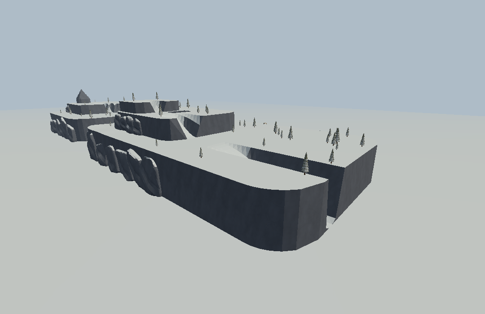
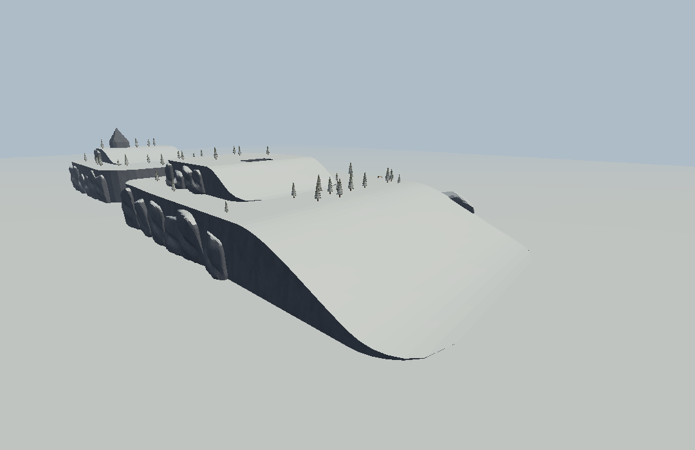
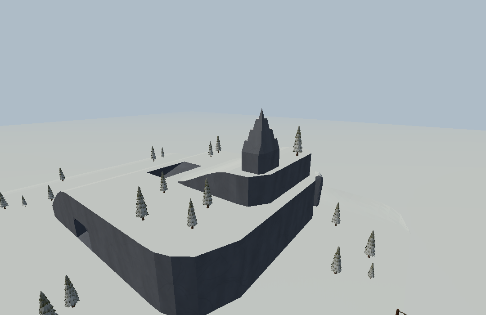

# Ярусы и входы

Ветка `track/tiers-entries` выросла из `f79fcb7`. Код геометрии и физический тест соответствуют `57b8210`. Для игры откройте отдельную ветку `integration/mountains-1`, где к ярусам подключены персонаж, проходы и мост.

```sh
npm run dev -- --host 127.0.0.1 --port 5184
```

[Узкий вырез, сид 42](http://127.0.0.1:5184/experiments/plateau/route.html?seed=42) · [Широкий подъём, сид 7](http://127.0.0.1:5184/experiments/plateau/route.html?seed=7) · [Четыре яруса, сид 8191](http://127.0.0.1:5184/experiments/plateau/route.html?seed=8191)

Персонаж появляется у западного подхода и смотрит вверх по склону. Для широкого подъёма достаточно удерживать W. На сиде 42 видимый снежный вырез ведёт на первое плато, следующий вырез начинается дальше по той же стороне второго яруса. Мост связывает первые плато главной и соседней горы. От площадки на дальней стороне можно подняться выше, если у горы есть следующий жилой ярус.

## Кадры из игры

Оба входа сняты из одной точки с одинаковой камерой. Для пика камера перенесена к третьему ярусу.

| Узкий вырез | Широкая сторона | Скалистая вершина |
|---|---|---|
| [](42-cut.png) | [](07-wide.png) | [](8191-peak.png) |

## Распределение

Числа в каждой паре относятся к главной и соседней горе соответственно. У соседней горы первый ярус доступен с моста. В таблице для неё указан тип подъёма со своего первого яруса выше.

| Сид | Ярусы | Входы | Недоступные вершины | Деревья | Треугольники скалы + снега |
|---:|---|---|---|---:|---:|
| 42 | 3 / 3 | узкий / узкий | соседняя, ярус 3 | 52 | 19 948 + 10 260 |
| 7 | 2 / 3 | широкий / широкий | соседняя, ярус 3 | 50 | 18 646 + 10 032 |
| 8191 | 4 / 1 | широкий / один ярус | главная, ярус 4 | 48 | 18 600 + 9 770 |
| 3 | 2 / 2 | узкий / широкий | — | 50 | 21 564 + 10 388 |
| 23011, новый | 2 / 1 | узкий / один ярус | — | 46 | 17 552 + 9 227 |

## Проверки

| Критерий | Результат | Наблюдение |
|---|---|---|
| T1. От одного до четырёх ярусов | PASS | На пяти сидах все четыре количества присутствуют. |
| T2. Жилое плато и острый пик | PASS | На каждом жилом ярусе проверено не менее двух деревьев. На пиках отсутствуют деревья и снежная площадка. Регрессии сидов 46, 53 и 55 проверены отдельно. |
| T3. Достижимость | PASS на пяти сидах | Обход графа по пересечениям лучей с коллайдером достигает всех жилых ярусов и останавливается перед пиком. Капсула по каждому подъёму прошла до верха и обратно. Низ пика имеет вертикальный участок высотой 3 м. Для сравнения, игровая скорость прыжка 4,3 м/с при ускорении 9,81 м/с² даёт менее 1 м подъёма. |
| T4. Остальная гора | Частично | Материал скалы и исходный генератор выступов используются на отдельном маршрутном стенде. Высота первого плато здесь 14 м. Перенос ярусов на полный регион игры не проводился. |
| E1. Два вида входа | PASS | На сиде 3 обе горы одной сцены используют разные виды. Каждый проходимый подъём внутри горы использует один и тот же вид. |
| E2. Вариативность выреза | PASS | Для первого яруса ширина снежного коридора задаётся в диапазоне 5–8 м, длина 39–44 м, изгиб до 3 м от оси. На сидах 42, 3 и 23011 фактические длины составили 42,35, 39,37 и 40,54 м. Ширина пола на четверти подъёма при допуске высоты 0,5 м составила 4,70, 6,15 и 6,20 м. |
| E3. Ходьба | PASS | Браузерный Player прошёл оба вида клавишей W. На сидах 42, 7 и 8191 диагностический поворот камеры и фиксированные такты дали высоту 14,02–14,03 м. В отдельном прогоне на обычной игровой странице сид 7 пройден с одной зажатой W и часами игрового движка. Позиция ног сместилась с (−65, 0,04, −15) до (−14,70, 14,03, −14,90). |
| Детерминизм | PASS | При повторной генерации совпали SHA-256 геометрии, леса, маршрутов и опор на каждом из пяти сидов. |

[Замеры физики и SHA-256](physics.json) · [Камеры и пути игрового персонажа](browser.json) · [Ходьба с обычной скоростью симуляции](live-walk.json)

Для проверки геометрии выполняйте команды из корня проекта. Браузерные команды требуют работающего интеграционного стенда, Playwright и Chromium. Адрес стенда можно передать через `SLICE_BASE_URL`, путь к браузеру — через `CHROMIUM`.

```sh
node experiments/plateau/slice-terrain.test.cjs
node experiments/plateau/slice-terrain-browser.cjs
node experiments/plateau/slice-terrain-browser.cjs --live
```

Отдельный тест T+E устанавливает персонажа у западного подножия и проверяет главную гору. Затем он проверяет ярусы соседней горы с точки крепления моста. Контроль без моста подтверждает недоступность этой точки с земли. Полный маршрут между горами, измерения всего кадра и бюджет сопоставлены в общем отчёте интеграции.

## Геометрия и подключение

Состоянием владеет чистая функция `generateSliceTerrain(seed, { passages })`. Расчёт по координатам и индексированная физическая сетка используют одинаковые треугольники. Широкий склон занимает западную короткую сторону, у узкого входа разные по сиду длина, изгиб и ширина. Маршрутный стенд использует игровой регулятор персонажа с допустимым подъёмом 48°. Основной риск находится в местах стыка сеток, где небольшой порог цепляет капсулу. Автообход его не всегда замечает, поэтому капсула проходит точки маршрута непрерывно в обе стороны.

Главная и соседняя горы имеют общую высоту первого плато 14 м. Центры крепления моста находятся в точках (59, 14, 0) и (91, 14, 0). Проход через скалу поднимается с (17, 14, 14) на (17, 22, −10). Тупик начинается в (15, 0, 34). Первый параметр при одиночном вызове — беззнаковый 32-битный сид. Лес и геометрия вычисляются заново при загрузке сцены, записей в сохранение нет.

Базовый стенд боковины доступен в `experiments/plateau/mountain.html`. Для отката всего эксперимента можно открыть этот стенд на `f79fcb7`.
