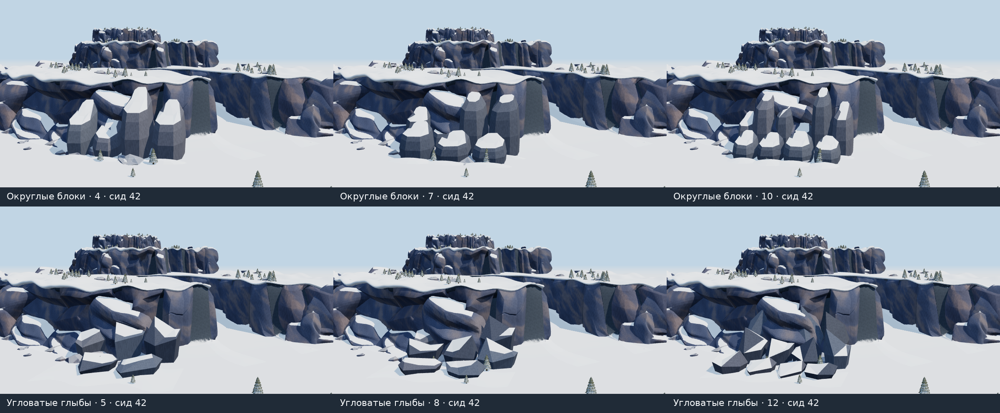
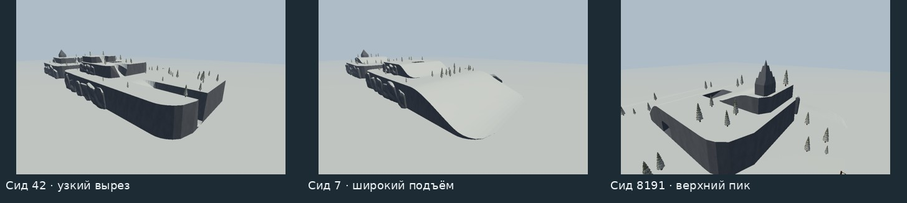
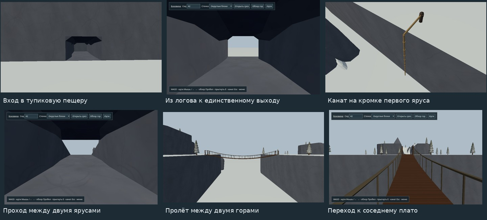

# Горы Nimble in the Forest

**Отчёт о работе и публикации · 23 ноября 2026 года · Самара (UTC+4)**

На GitHub Pages опубликован интерактивный тест `fe4277c`. В нём шесть вариантов боковины на старой полноразмерной горе и отдельная пешая сцена с ярусами, канатом, двумя пещерами и мостом. Боковины визуальную приёмку не прошли. В этой версии остались те же формы, которые вызвали замечание. Пеший срез и его возможности описаны отдельно ниже. [Открыть тест на GitHub Pages](https://depthd.github.io/nimbleintheforest/test/experiments/plateau/review.html)

[Файлы аудита](https://github.com/depthd/nimbleintheforest/tree/task/MOUNTAINS-AUDIT-001-report/docs/mountains-slice/audit-2026-11-23) · [Архивы для скачивания](https://github.com/depthd/nimbleintheforest/releases/tag/mountains-audit-2026-11-23) · [Хронология в TSV](https://raw.githubusercontent.com/depthd/nimbleintheforest/task/MOUNTAINS-AUDIT-001-report/docs/mountains-slice/audit-2026-11-23/commits.tsv) · [Git-патч публикации](https://raw.githubusercontent.com/depthd/nimbleintheforest/task/MOUNTAINS-AUDIT-001-report/docs/mountains-slice/audit-2026-11-23/pages.patch)

## 1. Что было на старте

Работу продолжил от `f79fcb7` — коммита с архивом гор. В нём уже были полноразмерная трёхъярусная сцена, старые маршруты, исходная боковина и журнал попыток. Из образцов особенно важны `5a6981b` с крупными округлыми массами, `50587b6` с угловатой скалой и `9b0fd70` со слоями. Слово «отвергли» пользователя относилось к конкретному `9b0fd70`. Для `5a6981b` формулировка пришла из отчёта агента. Для `50587b6` я внес её сам без подтверждения и затем исправил статус. Слоистое семейство осталось в истории, а переданный промпт для этой итерации включал два семейства боковины. [Архив на GitHub](https://github.com/depthd/nimbleintheforest/blob/f79fcb78595ee1d56df6854ccbe352d112a75649/docs/qa/PLATEAU-001/ARCHIVE.md) · [Контекст и владельцы кода](https://raw.githubusercontent.com/depthd/nimbleintheforest/fe4277c96426aeaa09c0ddbd208ade1d7b33f2ab/docs/mountains-slice/CONTEXT.md)

Первые четыре концепт-листа из этого чата содержат 24 формы для сравнения. Для поручений по боковине взяты листы 01–03 и 13–15, архивное сравнение, кадр `50587b6` и пять игровых референсов The Long Dark на контраст снега и тёмной скалы. Исходный ZIP с девятью кадрами The Long Dark не удалось получить. Его перечень есть в архиве. В комплекте для агентов я убрал незаполненную секцию «Дополнение владельца», где было только `[…]`. Обе исходные загрузки и подготовленный комплект сохранены. [Входное задание](https://raw.githubusercontent.com/depthd/nimbleintheforest/task/MOUNTAINS-AUDIT-001-report/docs/mountains-slice/audit-2026-11-23/input/mountains-orchestrator-prompt.md) · [Рабочие правила](https://raw.githubusercontent.com/depthd/nimbleintheforest/task/MOUNTAINS-AUDIT-001-report/docs/mountains-slice/audit-2026-11-23/input/universal-agent-prompt%281%29.md) · [Приложенные кадры](https://github.com/depthd/nimbleintheforest/releases/tag/mountains-audit-2026-11-23) · [Исторические варианты](https://github.com/depthd/nimbleintheforest/blob/f79fcb78595ee1d56df6854ccbe352d112a75649/docs/qa/PLATEAU-001/ARCHIVE.md)

## 2. Хронология решений

| Этап | Что сделал и почему | Наблюдаемый результат |
|---|---|---|
| До начала разработки | Собрал исходные промпты, карточки и изображения. Сохранил исходную камеру и кадр с базы, чтобы сравнение было воспроизводимо. | `bd95225`. Исходный кадр 800 × 450, видны 2 097 636 треугольников. [Базовый кадр](https://raw.githubusercontent.com/depthd/nimbleintheforest/fe4277c96426aeaa09c0ddbd208ade1d7b33f2ab/docs/mountains-slice/integration/baseline/original-0-42.png) |
| 11:44–11:51 | Запустил шесть агентов на семи направлениях. Ярусы и входы отдал одному агенту, обе задачи меняли одну сетку. Пещеры, канат и мост получили координаты посадок от генератора рельефа. Для каната после общего разрешения продолжать сделал отдельное движение капсулы. | Планы и критерии сохранены по каждому направлению. Ранние источники `2e4f0a8`, `3ac859f`, `6db559d`, `8445117`, `bb3daf9`, `24d7b6e`, `3c12120`. [Планы и промпты](https://github.com/depthd/nimbleintheforest/tree/fe4277c96426aeaa09c0ddbd208ade1d7b33f2ab/docs/mountains-slice/briefs/) |
| 11:51–12:09 | Сошёлся на двух сценах. В исходной крупной горе заменялся выбранный участок декоративной боковины. Для маршрута собрал две горы в масштабе персонажа и подключил игровой контроллер и Rapier. Это позволило проверить коллизии и весь путь раньше переноса в игровой регион. | `ad48bda` объединил сцены. Код воспроизводит начальное положение, направляет ходьбу по маршруту и использует настоящие столкновения рельефа. [Скрипт маршрута](https://raw.githubusercontent.com/depthd/nimbleintheforest/fe4277c96426aeaa09c0ddbd208ade1d7b33f2ab/docs/mountains-slice/integration/walk-route.cjs) · [Кадры](https://raw.githubusercontent.com/depthd/nimbleintheforest/fe4277c96426aeaa09c0ddbd208ade1d7b33f2ab/docs/mountains-slice/integration/journey.jpg) |
| 11:55–12:17 | Развёл снег на самой стенке и снег у её подножия. У округлых масс изменил плечи и верхние скосы. Для угловатых клиньев пересчитал пятна по наклону, гребню и ветру. Дважды переснимал набор после изменений. | `424aa56`, `dcbeb96`. Фактические шесть значений оказались в диапазоне около четверти видимой стенки. [Первые и итоговые кадры](https://github.com/depthd/nimbleintheforest/releases/tag/mountains-audit-2026-11-23) · [Маски](https://raw.githubusercontent.com/depthd/nimbleintheforest/fe4277c96426aeaa09c0ddbd208ade1d7b33f2ab/docs/mountains-slice/integration/final-walls/report.json) |
| 12:08–12:20 | Проверил цельность мешей, зазоры между массами, попадание в прежнюю плоскую плиту и влияние теней. Для времени отрисовки ввёл синхронное чтение пикселя в одной и той же камере. | Все 225 пар масс в восьми проверенных вариантах разделены. Тень меняет 775–1 318 пикселей вне стенки. При снятом приёме теней за пределами замены все пиксели совпали. [Проверка пересечений](https://raw.githubusercontent.com/depthd/nimbleintheforest/fe4277c96426aeaa09c0ddbd208ade1d7b33f2ab/docs/mountains-slice/integration/wall-intersections.md) · [Тени](https://raw.githubusercontent.com/depthd/nimbleintheforest/fe4277c96426aeaa09c0ddbd208ade1d7b33f2ab/docs/mountains-slice/wall-rounded/outside-wall.json) |
| 12:20–12:29 | На близком проходе камеры заметил серый пунктир по снежному гребню WB8. Первая проба усилила смещение глубины снега. Это убрало точки, но захватило часть соседней скалы и ёлки. | `dbe4a81` проба, `0f16724` откат. Причина пунктира подтверждена отдельным WebGL-замером с 4×MSAA. [Отклонённая проба](https://github.com/depthd/nimbleintheforest/releases/tag/mountains-audit-2026-11-23) |
| 12:37–12:48 | Утопил только скрытый участок скалы под полностью заснеженным острым гребнем. Снежная геометрия и внешний силуэт остались прежними. Повторил серию сближения, пересечения, снеговые маски, два пеших прогона и бюджет. | `ed02069` → сборка `cb4e6f4` → отчёт `3910d95`. Пунктир исчез на семи углах. В вершине трёх граней остаётся один смешанный пиксель. Сравнение девяти камер показало, что покрытие соседних объектов не изменилось. [Гребень до и после](https://raw.githubusercontent.com/depthd/nimbleintheforest/fe4277c96426aeaa09c0ddbd208ade1d7b33f2ab/docs/mountains-slice/wall-angular/snow-ridge-before-after.jpg) |
| Обращение за браузерным тестом | Начал страницу просмотра. После замечания по кадру сам предложил переделку формы, хотя такой задачи на этом этапе не было. Остановил работу и агента по прямому возражению. После «гитхаб делай» продолжил только просмотр и размещение готовых вариантов. | Ни будущий эскиз, ни новая форма в опубликованную версию не вошли. [Точный diff публикации](https://raw.githubusercontent.com/depthd/nimbleintheforest/task/MOUNTAINS-AUDIT-001-report/docs/mountains-slice/audit-2026-11-23/pages.patch) |
| 16:01–16:03 | Добавил просмотр боковины, стартовые точки, режимы и галерею. Запустил действующий workflow тестов на GitHub Pages. Он взял ранее опубликованную игру из её артефакта, сравнил с живой версией и заменил каталог `/test/`. | Опубликован `fe4277c`. Главный HTML и `version.json` сравнил побайтно до и после. На внешнем URL проверил переключатели, клавиши и четыре точки старта. [GitHub Actions](https://github.com/depthd/nimbleintheforest/actions/runs/45170497798) · [Проверки публикации](https://raw.githubusercontent.com/depthd/nimbleintheforest/task/MOUNTAINS-AUDIT-001-report/docs/mountains-slice/audit-2026-11-23/github-actions.json) |

Часы в таблице получены из Git и GitHub Actions. Моменты без отдельного коммита восстановлены по сохранённым сообщениям и файлам. Полная таблица включает каждый коммит работ и его родителей. [Все коммиты](https://raw.githubusercontent.com/depthd/nimbleintheforest/task/MOUNTAINS-AUDIT-001-report/docs/mountains-slice/audit-2026-11-23/commits.tsv) · [Порядок интеграции](https://raw.githubusercontent.com/depthd/nimbleintheforest/task/MOUNTAINS-AUDIT-001-report/docs/mountains-slice/audit-2026-11-23/integration.tsv) · [Файлы по каждому коммиту](https://raw.githubusercontent.com/depthd/nimbleintheforest/task/MOUNTAINS-AUDIT-001-report/docs/mountains-slice/audit-2026-11-23/commits-files.txt)

## 3. Что разработано по каждому заданию

### Боковина · округлые блоки и угловатые глыбы

**Округлые блоки, WA.** Генератор строит по сиду 4, 7 или 10 замкнутых масс. Поперечное сечение со скошенными углами поднимается несколькими кольцами. Ширина, высота и скос меняются. Верхние треугольники по наклону получают снег, у подошвы добавляются отдельные низкие сугробы. Выбор пресета меняет индексы только передней части декоративной сетки и возвращает камеру к заданной точке. Технически при переключении исходная боковина восстанавливается пиксель в пиксель. [План WA](https://raw.githubusercontent.com/depthd/nimbleintheforest/fe4277c96426aeaa09c0ddbd208ade1d7b33f2ab/docs/mountains-slice/briefs/WA.md) · [Измерения WA](https://raw.githubusercontent.com/depthd/nimbleintheforest/fe4277c96426aeaa09c0ddbd208ade1d7b33f2ab/docs/mountains-slice/wall-rounded/README.md)

**Угловатые глыбы, WB.** Генератор строит 5, 8 или 12 замкнутых клиньев с ломаным гребнем, распределённых рядами от стены к подошве. Снежные пятна получаются отсечением верхних граней по накоплению снега и уклону. В последние правки отдельно проверил опору под снегом и утопил камень под закрытым гребнем. Лучи показали, что тёмная плита справа принадлежит исходному борту вырезанного подъёма. Поэтому она осталась видимой. [План WB](https://raw.githubusercontent.com/depthd/nimbleintheforest/fe4277c96426aeaa09c0ddbd208ade1d7b33f2ab/docs/mountains-slice/briefs/WB.md) · [Варианты и лучи](https://raw.githubusercontent.com/depthd/nimbleintheforest/fe4277c96426aeaa09c0ddbd208ade1d7b33f2ab/docs/mountains-slice/wall-angular/README.md)

| Вариант | 4 или 5 масс | 7 или 8 масс | 10 или 12 масс |
|---|---:|---:|---:|
| Округлые блоки · снег на стенке | 26,83% | 24,36% | 24,83% |
| Угловатые глыбы · снег на стенке | 25,61% | 27,58% | 27,22% |

В долю включены видимый камень и снег на стенке, а сугроб у основания посчитан отдельной маской. Замеры выполнены на сиде 42 в движке с реальными перекрытиями. Медианы программной отрисовки в Chromium/SwiftShader составили 2,55–3,18 с на один синхронный проход при 2,68 с у исходника. Это замер стенда рендеринга. Замера FPS на игровом GPU нет. [Сырые замеры](https://raw.githubusercontent.com/depthd/nimbleintheforest/fe4277c96426aeaa09c0ddbd208ade1d7b33f2ab/docs/mountains-slice/integration/wall-timing.json)

**Почему кадр не сработал.** Подмена затронула декоративные массы, а несущая скальная поверхность сохранила старый контур. Высокие округлые блоки похожи на отдельно поставленные столбы с белыми крышками. Угловатые клинья образуют кучку перед стенкой, потому что у рядов есть вынос вперёд, а исходная поверхность продолжается за ними. Тёмная плита справа усиливает впечатление накладной детали. Я проверял снег, зазоры и мерцание уже после того, как общая композиция в кадре показала эту проблему. Ошибка была в том, что я обозначил технически работающие варианты как доведённую боковину до визуальной оценки. [Сравнение на сиде 23011 до локальной правки гребня](https://raw.githubusercontent.com/depthd/nimbleintheforest/task/MOUNTAINS-AUDIT-001-report/docs/mountains-slice/audit-2026-11-23/side-by-side-before-ridge.jpg)

### Ярусы и входы · T и E

**Ярусы.** Две горы собираются по сиду. В проверочной выборке встречаются 1, 2, 3 и 4 яруса. Жилые террасы имеют деревья и связный подход. Пики без доступа сделаны крутыми, без леса и плоской снежной площадки. Выборка 0–84 выявила пустой лес на трёх небольших террасах. После исправления на каждой жилой террасе осталось не меньше двух деревьев. [План T](https://raw.githubusercontent.com/depthd/nimbleintheforest/fe4277c96426aeaa09c0ddbd208ade1d7b33f2ab/docs/mountains-slice/briefs/T.md) · [Таблица и доказательства](https://raw.githubusercontent.com/depthd/nimbleintheforest/fe4277c96426aeaa09c0ddbd208ade1d7b33f2ab/docs/mountains-slice/tiers-entries/README.md)

**Входы.** На главной горе правая и левая границы подъёма получаются из сетки рельефа. У широкой версии короткая сторона переходит в наст плавно. Узкая версия вырезает извилистый коридор с меняющимися шириной, длиной и изгибом. На реальном проходе через узкий вход капсула зацепилась за высокое ребро в стыке, его исправили. Затем отдельно проверили, что соседние горы умеют независимо выбирать тип подъёма. Сид 3 показывает это в одной сцене. На узком и широком подходах персонаж реально поднялся до первого плато. Для широкой версии на сиде 7 есть отдельный прогон обычным вводом в реальном времени. [План E](https://raw.githubusercontent.com/depthd/nimbleintheforest/fe4277c96426aeaa09c0ddbd208ade1d7b33f2ab/docs/mountains-slice/briefs/E.md) · [Лог реального ввода](https://raw.githubusercontent.com/depthd/nimbleintheforest/fe4277c96426aeaa09c0ddbd208ade1d7b33f2ab/docs/mountains-slice/tiers-entries/live-walk.json)

### Канат, сквозная пещера и логово · P

**Канат.** В нижней точке игрок по E берётся за канат. W и S задают ход капсулы вдоль ломаной. Каждый шаг рассчитывает Rapier, поэтому препятствие останавливает продвижение. На верхней кромке траектория заходит на площадку и возвращает игрока к ходьбе. На проверенных сидах набор высоты около 14 м. [Решение и коллизии](https://raw.githubusercontent.com/depthd/nimbleintheforest/fe4277c96426aeaa09c0ddbd208ade1d7b33f2ab/docs/mountains-slice/passages/DECISION.md) · [Кадр](https://raw.githubusercontent.com/depthd/nimbleintheforest/fe4277c96426aeaa09c0ddbd208ade1d7b33f2ab/docs/mountains-slice/passages/browser/rope-and-anchor.jpg)

**Сквозная пещера.** Два портала находятся в одной сцене. Капсула проходит по наклонному полу с первого плато на 14 м до второго на 22 м, может развернуться и вернуться. Физика использует пол, потолок и стены видимой пещеры. **Логово.** Другая полость находится у основания. Капсула проходит до каменного задника, который останавливает движение, и возвращается через тот же вход. Для укрытия сохранены геометрия и точка входа. [План P](https://raw.githubusercontent.com/depthd/nimbleintheforest/fe4277c96426aeaa09c0ddbd208ade1d7b33f2ab/docs/mountains-slice/briefs/P.md) · [Трассы и кадры двух пещер](https://github.com/depthd/nimbleintheforest/tree/fe4277c96426aeaa09c0ddbd208ade1d7b33f2ab/docs/mountains-slice/passages/)

### Подвесной мост · B

Автоматический выбор пары опор использует доступность террас и проверяет свободный коридор по рельефу и деревьям. Статичный настил, крепления и канаты используют одну линию пролёта. У настила собственная геометрия коллайдера. Для стенда измерил 30 м чистого разрыва, 32 м между опорами, 1,765 м провиса. На четырёх сидах прошли восемь переходов в обе стороны. При снятом настиле граф теряет путь к спутнику, а капсула падает в проход между горами и упирается в дальнюю стену. В проходе камеры мост добавляет 4 588 треугольников и три вызова отрисовки, коллайдер содержит 218 треугольников. 32 м — предложение на основе измеренных берегов стенда. [План B](https://raw.githubusercontent.com/depthd/nimbleintheforest/fe4277c96426aeaa09c0ddbd208ade1d7b33f2ab/docs/mountains-slice/briefs/B.md) · [Трассы, замеры, кадры](https://raw.githubusercontent.com/depthd/nimbleintheforest/fe4277c96426aeaa09c0ddbd208ade1d7b33f2ab/docs/mountains-slice/bridges/REVIEW.md)

### Референсы · R

Собрал четыре листа по шесть разборов. На каждом листе три игровых ситуации и три натурных аналога. На основе источников сделаны авторские эскизы формы. Готовых игровых текстур и чужих моделей в тест из этих листов не переносил. Список источников сопровождает пояснение по каждой панели. Для части статей доступ был через поисковый индекс. [План R](https://raw.githubusercontent.com/depthd/nimbleintheforest/fe4277c96426aeaa09c0ddbd208ade1d7b33f2ab/docs/mountains-slice/briefs/R.md) · [Четыре листа и источники](https://raw.githubusercontent.com/depthd/nimbleintheforest/fe4277c96426aeaa09c0ddbd208ade1d7b33f2ab/docs/mountains-slice/references/README.md)

## 4. Что подтверждено на общей сборке

| Сид | Ярусы главной и соседней горы | Вход главной горы | Пройдено | Финиш на соседнем плато |
|---|---|---|---:|---:|
| 42 | 3 / 3 | Узкий | 442,51 м | 14,03 м |
| 7 | 2 / 3 | Широкий | 444,44 м | 14,03 м |
| 8191 | 4 / 1 | Широкий | 456,68 м | 14,03 м |
| 23011 | 2 / 1 | Узкий | 448,60 м | 14,03 м |

Каждая полная трасса идёт от спавна вокруг боковины, к тупику и обратно, вверх по канату, через верхнюю пещеру туда и обратно, затем по мосту. Браузер нажимает обычные кнопки. Диагностический интерфейс поворачивает камеру и продвигает фиксированные такты симуляции. Это одна загрузка и ни одного переноса позиции за весь проход. Мышь, захват указателя и ходьба в реальном времени проверены отдельным сценарием. После последней правки гребня заново проверены 42 и 7. [Все трассы и кадры](https://github.com/depthd/nimbleintheforest/releases/tag/mountains-audit-2026-11-23) · [Проверка в реальном времени](https://raw.githubusercontent.com/depthd/nimbleintheforest/fe4277c96426aeaa09c0ddbd208ade1d7b33f2ab/docs/mountains-slice/integration/realtime/README.md) · [Логи тестов](https://github.com/depthd/nimbleintheforest/releases/tag/mountains-audit-2026-11-23)

## 5. Что именно изменилось в GitHub Pages

Коммит `fe4277c` добавляет HTML, CSS и TypeScript страницы просмотра, связывает её с двумя сценами, вводит стартовые положения у элементов маршрута и выводит ссылку в меню теста. На вкладке боковин используется тот же генератор и та же полноразмерная гора. В пешей сцене стартовые точки выставляют обычную позицию игрока на земле, у портала, каната или перед мостом. При ходьбе после старта работают прежние коллизии. В галерее лежат кадры и референсы. [Изменения коммита](https://github.com/depthd/nimbleintheforest/commit/fe4277c96426aeaa09c0ddbd208ade1d7b33f2ab)

Публикацию провёл через действующий workflow `test-pages.yml`, с публикацией отдельного каталога `/test/`. После выкладки проверил, что сервер отдаёт полный SHA `fe4277c96426aeaa09c0ddbd208ade1d7b33f2ab`, переключение меняет канвас, исходный пресет восстанавливает кадр, ссылка на мост открывает правильный сид, указатель захватывается и галерея открывает изображение. На опубликованном адресе из четырёх стартов отдельно запустил проверки логова, каната, сквозной пещеры и моста. Первый кадр интерфейса снят с опубликованного URL при подготовке отчёта. Кадр узкого экрана из локальной проверки подписан mobile-local-preview. [Снимки страницы](https://raw.githubusercontent.com/depthd/nimbleintheforest/task/MOUNTAINS-AUDIT-001-report/docs/mountains-slice/audit-2026-11-23/01-wall-original.jpg) · [Вывод браузерной проверки](https://raw.githubusercontent.com/depthd/nimbleintheforest/task/MOUNTAINS-AUDIT-001-report/docs/mountains-slice/audit-2026-11-23/mtn-pages-live-browser.log) · [Run на GitHub](https://github.com/depthd/nimbleintheforest/actions/runs/45170497798)

## 6. Что осталось по результату

- **Боковины.** Форма на полноразмерной горе не принята. Основная проблема видна на общей камере. Локальная правка гребня решила пунктир, а у вершины трёх граней под увеличением остался один смешанный пиксель. Съёмка всех шести пресетов сделана с одной камеры, столь же близкая серия — для двух средних пресетов.
- **Ярусы, входы, пещеры, мост.** Они работают на тестовой карте с первым плато высотой 14 м. Подтверждения работы в полной игровой генерации нет.
- **Тени.** Строгий критерий полного совпадения кадра вне стенки при обычном освещении не пройден из-за падающей тени.
- **Бюджет.** Есть число треугольников и замеры программного рендера, а аппаратный замер на игровом GPU открыт.
- **Лимит.** Расход сообщений, токенов или лимита по задачам недоступен. Из файлов можно подтвердить виды работы, время коммитов, прогоны и количество снятых кадров. Много циклов ушло на коллизии, повторные замеры снега, пересъёмку и исправление шва, тогда как дефект композиции был виден по общему ракурсу.

## 7. Как воспроизвести

Для результата без установки Node распакуйте архив и запустите `python 06-pages/start.py`. На Windows можно использовать `py 06-pages/start.py`. Сервер слушает только этот компьютер и открывает локальную сборку интерактивного теста. Для пешего режима нужны клавиатура и мышь. Файлы в `06-pages/build/` собраны заново из опубликованного коммита, а время сборки в HTML соответствует подготовке отчёта.

Для исходников и всех веток нужен Git и исходный коммит `f79fcb7` из GitHub. В `05-source/RESTORE.md` записаны команды. Архив истории содержит оба направления боковины, ярусы с входами, проходы, мост, референсы, интеграцию и ветку Pages. Git-патчи и исходники, тесты с входными данными, снимки и сырые JSON находятся в соответствующих папках архива. [Как восстановить разработку](https://raw.githubusercontent.com/depthd/nimbleintheforest/task/MOUNTAINS-AUDIT-001-report/docs/mountains-slice/audit-2026-11-23/RESTORE.md) · [Опись и хеши файлов](https://github.com/depthd/nimbleintheforest/releases/tag/mountains-audit-2026-11-23)
