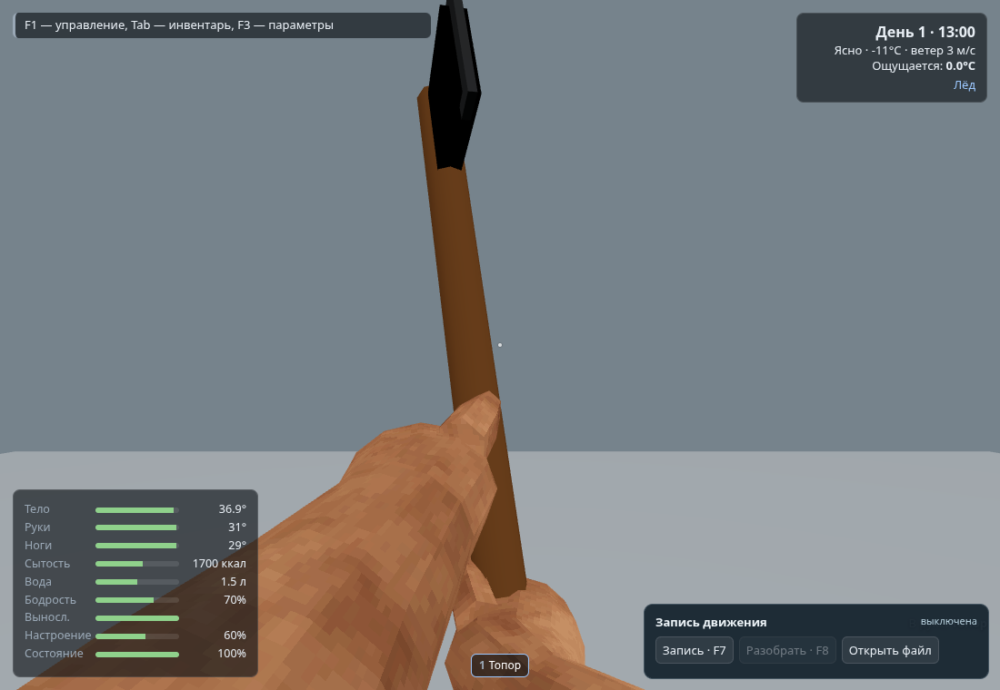
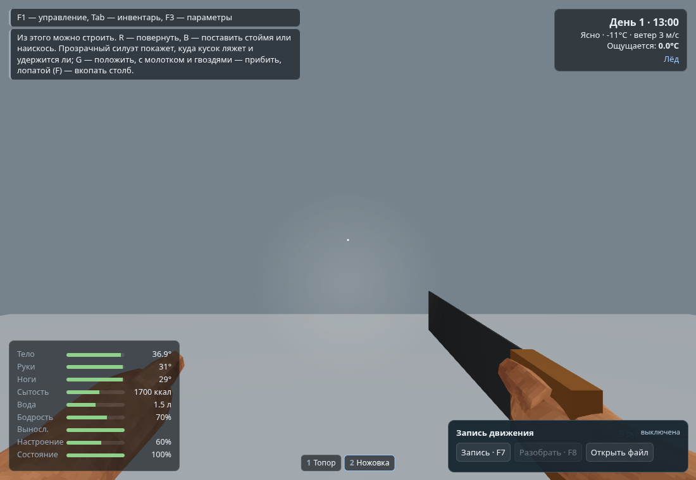
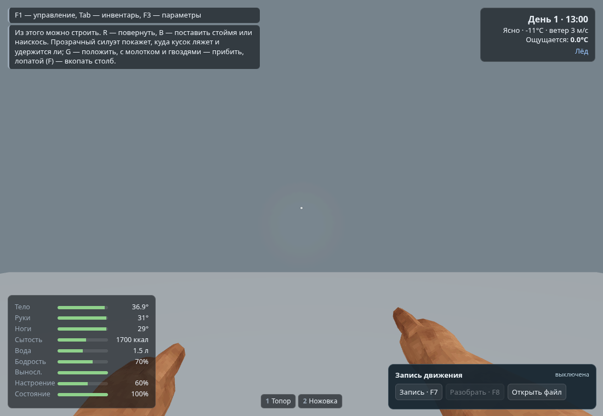
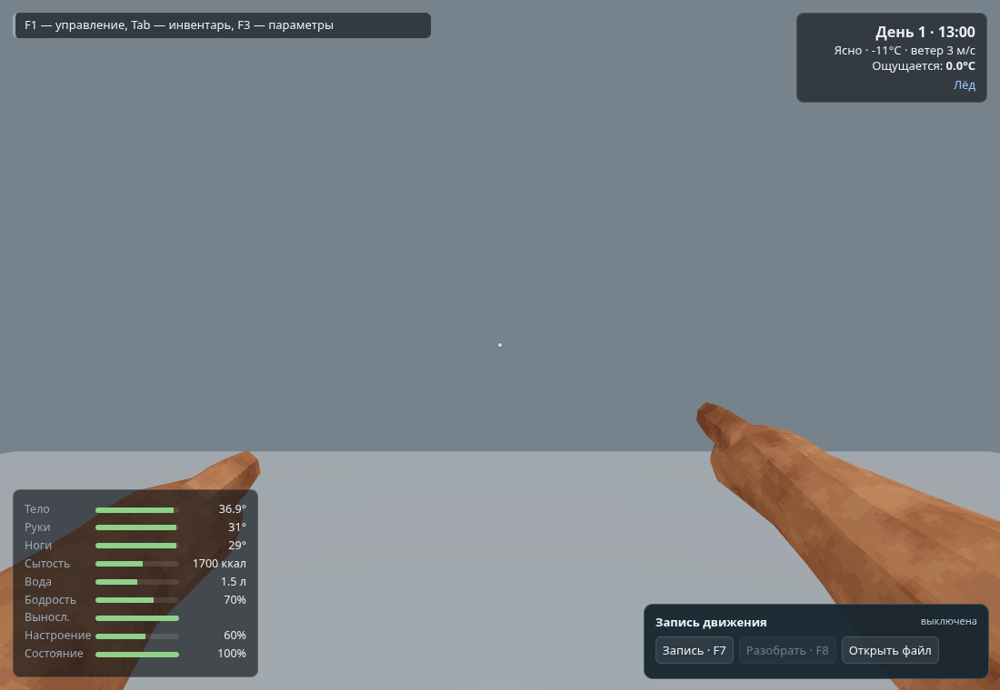
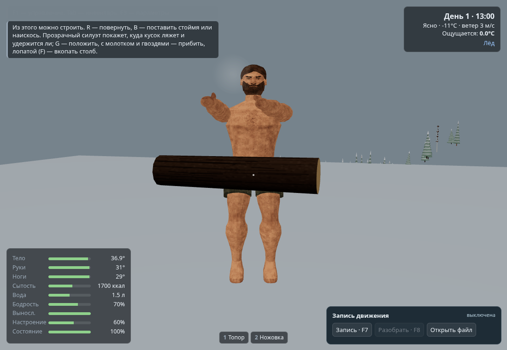

# HANDS-001 self QA

Source SHA: `62067a55cdaa8ec5b95332dc608966cf03ebc416`.
Integration base: `de20db3bb8883af6ade9afb5bb418b708afd9d71`.

Build, arm solver checks (503 reach/singularity cases), 21 locomotion checks,
7 motion recording checks, 17 snow checks and 5 snow-cover checks passed.
Browser fixtures passed all 18 hand states and checked actual skinned wrist/IK
agreement below 0.1 mm, with no page errors. See browser.txt.

An earlier hand-pose revision also passed all 25 existing Survivor checks,
including mask, legs, eyes and wide-viewport camera clearance. The final revision
has a separate camera-clearance rerun; see clearance.txt.

This is self QA, not independent Kimi review or user visual approval. Screenshots
use an isolated render stage to make poses easy to inspect. They are prototype
poses, not an assertion of polished grips or physical hand/object collisions.
The third-person fixture shows the same skinned body after the throw fixture;
a previously spawned carried log remains in that fixture's world.

## Preview

