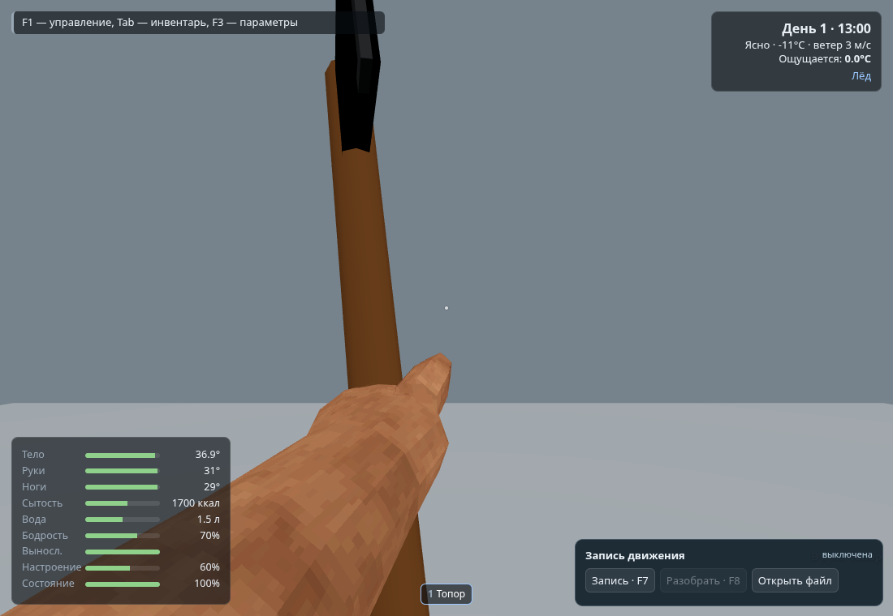
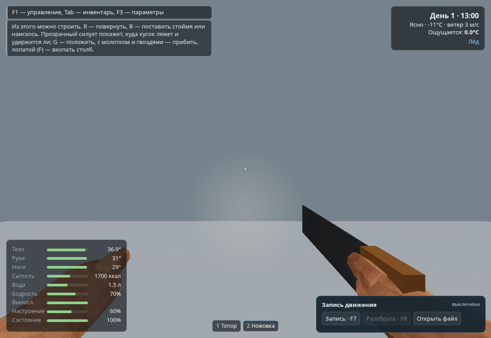

# Coupled-grip self QA

Source: bc593d85039582b681db02baf53a916e5f93da3e.

Build, 503 arm cases, 600 rigid reach/conversion cases, 21 locomotion checks and
7 recording checks passed. The ordinary hand-mode fixtures passed 18 states.
Wide-camera clearance passed all 14 checks with no JS/shader/resource errors.
The final grip-browser run tests both controlled poses and live frame order;
see grip.txt for measured errors and results, including physical carried sockets.

The isolated hand-mode images show existing placeholder art. No new axe model or
clip is provided; this is the shared attachment and animation-integration basis.
Self QA does not replace independent QA or user visual approval.

